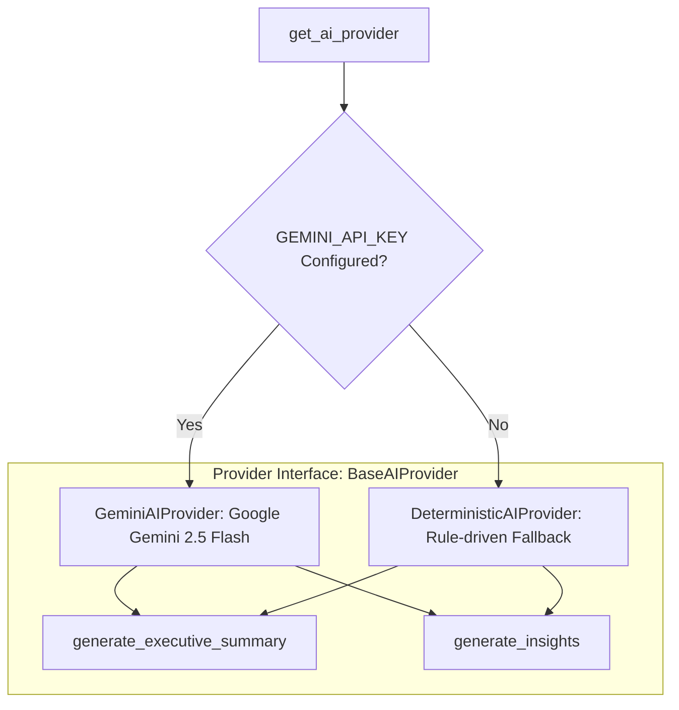

# AI Engineering Insights Architecture — Developers Code Pulse (DCP)

## 1. Overview & Vision

The **AI Engineering Insights Engine** in Developers Code Pulse (DCP) bridges the gap between raw engineering telemetry and actionable workflow improvements. Rather than simply displaying dashboards of numbers, DCP synthesizes telemetry into natural-language explanations, root-cause diagnostics, and evidence-backed recommendations.

Crucially, the AI engine is **grounded entirely in verified analytics**. It acts as an analytical interpreter rather than an unconstrained generator, strictly observing the **Anti-Surveillance Manifesto** and absolute metric traceability.

---

## 2. Core Safety & Grounding Principles

1. **Zero Hallucination / Zero Invented Metrics**:
   - The AI layer is strictly forbidden from computing or guessing metrics.
   - All numbers presented in summaries or recommendations must map directly to pre-calculated metrics supplied in the prompt payload.
2. **Absolute Traceability & Provenance**:
   - Every synthesized `AIInsight` entity stores a structured `evidence` dictionary alongside its explanation.
   - UI clients render these evidence chips directly below explanations so engineers can inspect the underlying metrics.
3. **Anti-Surveillance Guarantee**:
   - The engine analyzes team dynamics, review bottlenecks, pipeline latencies, and deployment frequencies.
   - It **never** evaluates individual developer velocity, personal lines of code, individual rankings, or surveillance metrics.
4. **Graceful Deterministic Fallback**:
   - When no external AI API key is configured or the external service is unreachable, the engine seamlessly switches to a pure rule-driven `DeterministicAIProvider`.
   - The system guarantees complete feature availability regardless of external AI connectivity.
5. **No Cross-Tenant Data Exposure**:
   - Prompts are constructed using strictly tenant-isolated data. No cross-organization context is ever included.

---

## 3. Provider Abstraction Architecture

DCP implements an extensible provider interface (`BaseAIProvider`) using the Factory design pattern:



### Base Interface (`backend/app/services/ai/base.py`)
```python
class BaseAIProvider(ABC):
    @abstractmethod
    async def generate_executive_summary(
        self,
        report_type: str,
        timeframe_label: str,
        metrics: dict[str, Any],
        comparison: dict[str, Any] | None = None,
    ) -> str:
        """Synthesize a grounded executive summary narrative."""
        pass

    @abstractmethod
    async def generate_insights(
        self,
        metrics: dict[str, Any],
        bottlenecks: list[dict[str, Any]],
        dora_overview: dict[str, Any] | None = None,
        comparison: dict[str, Any] | None = None,
        focus_areas: list[str] | None = None,
    ) -> list[dict[str, Any]]:
        """Synthesize structured, evidence-backed AI insights."""
        pass

    @property
    @abstractmethod
    def provider_name(self) -> str:
        pass
```

---

## 4. Provider Implementations

### A. `GeminiAIProvider` (`backend/app/services/ai/gemini_provider.py`)
- **Model**: Google `gemini-2.5-flash` via the official Google Generative Language REST API (`httpx.AsyncClient`).
- **Prompt Engineering**:
  - System instructions enforce strict metric grounding and the Anti-Surveillance Charter.
  - Metrics and baseline comparisons are serialized into structured JSON blocks.
  - Temperature is set conservatively (`0.2`) to eliminate creative hallucinations and enforce adherence to provided facts.
  - Output is constrained to JSON schemas parsing into title, explanation, evidence, recommendation, and confidence fields.
- **Resilience**:
  - Automatically traps HTTP timeouts, quota limits, and API errors, falling back immediately to `DeterministicAIProvider` without dropping requests.

### B. `DeterministicAIProvider` (`backend/app/services/ai/deterministic_provider.py`)
- **Zero-Dependency Fallback**: Fully deterministic Python heuristics that inspect:
  - Throughput shifts (e.g. PR volume deltas $> 10\%$).
  - Latency shifts (e.g. Cycle time improvements or regressions).
  - High and critical bottleneck counts from the Phase 6 Bottleneck Detection Engine.
  - DORA performance tiers (Elite, High, Medium, Low) and data completeness gaps.
- Guarantees $100\%$ uptime and reproducible insight generation even in air-gapped or offline development environments.

---

## 5. Insight Taxonomy & Schema

Every insight is classified into one of five functional types:

| Insight Type | Purpose | Visual Indicator | Example Trigger |
| :--- | :--- | :--- | :--- |
| `POSITIVE_TREND` | Celebrates measurable delivery improvements | Green Badge ($\uparrow$) | PR cycle time decreased by $> 15\%$ period-over-period |
| `DETERIORATING_TREND` | Alerts team to emerging delivery regressions | Red Badge ($\downarrow$) | Merge rate dropped below $70\%$ or turnaround time doubled |
| `WORKFLOW_BOTTLENECK` | Pinpoints specific review or pipeline blockages | Amber Badge ($\Delta$) | $\ge 2$ active high-severity review bottlenecks detected |
| `DORA_EVALUATION` | Evaluates deployment frequency and stability | Purple Badge ($\Omega$) | High deployment frequency paired with zero change failures |
| `SYSTEMIC_RECOMMENDATION` | Provides targeted process recommendations | Blue Badge ($\star$) | Review workload Gini coefficient indicates review concentration |

### `ai_insights` Database Schema (`backend/app/models/reports.py`)
- `id` (UUID, Primary Key)
- `organization_id` (UUID, Foreign Key)
- `repository_id` (UUID, Nullable Foreign Key)
- `insight_type` (VARCHAR: `POSITIVE_TREND`, `DETERIORATING_TREND`, `WORKFLOW_BOTTLENECK`, etc.)
- `title` (VARCHAR)
- `explanation` (TEXT)
- `evidence` (JSONB: explicit key-value metric pairs)
- `recommendation` (TEXT, Nullable)
- `confidence` (FLOAT: $0.0$ to $1.0$)
- `provider` (VARCHAR: e.g. `gemini` or `deterministic`)
- `model` (VARCHAR: e.g. `gemini-2.5-flash` or `rules-engine-v1`)
- `generated_at` (TIMESTAMPTZ)
- `status` (VARCHAR: `ACTIVE`, `ACKNOWLEDGED`, `DISMISSED`)

---

## 6. API Endpoints

- `GET /api/v1/insights`: List stored insights with category, repository, and pagination filters.
- `GET /api/v1/insights/{id}`: Retrieve a specific insight with complete evidence dictionary.
- `POST /api/v1/insights/generate`: Trigger an on-demand AI synthesis run for the organization or repository across a specified timeframe.

---

## 7. Security & Privacy Controls

1. **Credential Safety**: The Gemini API key is loaded from the environment (`settings.GEMINI_API_KEY`) and never committed to source control or logged in telemetry.
2. **Data Minimization**: AI prompts contain only aggregated numerical summaries (e.g., median hours, PR counts, bottleneck types). No source code, commit diffs, or developer emails are sent to the AI model.
3. **Tenant Boundary Enforcement**: Queries for metrics and bottlenecks enforce strict `organization_id` tenancy filters before prompt assembly.
