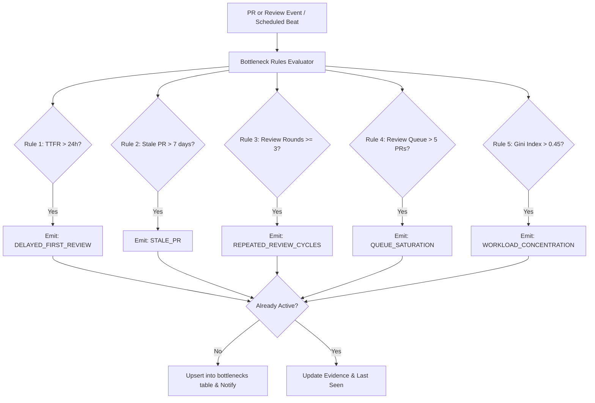

# DEVELOPERS CODE PULSE (DCP)
## Analytics Engine & Intelligence Specification

---

## 1. Analytics Architecture & Separation of Concerns

Developers Code Pulse enforces strict architectural separation between **data storage**, **metric computation**, and **API presentation**. 

Metric formulas are never embedded in frontend React components or raw API route handlers. All computations reside within the dedicated service layer:
```
backend/app/services/analytics/
    ├── commit_metrics.py
    ├── pull_request_metrics.py
    ├── review_metrics.py
    ├── team_metrics.py
    ├── dora_metrics.py
    ├── bottleneck_engine.py
    ├── trend_analysis.py
    └── snapshot_engine.py
```

### Statistical Rigor: Medians and Percentiles Over Arithmetic Means
Software engineering turnaround metrics (review latency, merge time) follow heavy-tailed, non-Gaussian distributions (skewed by outliers like PRs forgotten over holiday periods).
- **Mean (Average):** Reported for baseline reference, but prone to extreme distortion.
- **Median (P50):** The primary indicator of typical developer experience.
- **P75 and P90 Percentiles:** Primary indicators of workflow friction, long-tail delays, and unblocking efficiency.

---

## 2. Complete Metric Definition Catalogue

### 2.1 Commit & Cadence Metrics

| Metric Name | Mathematical Formula | Inclusions & Exclusions | Missing Data Handling |
| :--- | :--- | :--- | :--- |
| **Commit Volume** | $V_c = \sum \text{Commits}$ | Monitored branches only. Excludes merge commits. | 0 if no commits. |
| **Commit Cadence** | $C_{daily} = \frac{V_c}{N_{\text{days}}}$ | Working days vs calendar days separated in reporting. | 0 if no commits. |
| **Active Contributors** | Count of distinct `author_account_id` with $\ge 1$ commit | Excludes known automation bot accounts (e.g., `dependabot[bot]`). | 0 contributors. |
| **Code Churn** | $\text{Churn} = \text{Additions} + \text{Deletions}$ | Excludes generated lockfiles (`package-lock.json`, `poetry.lock`). | Defaults to 0. |

---

### 2.2 Pull Request Lifecycle Metrics

#### 1. PR Merge Time
- **Definition:** The time elapsed from when a pull request is ready for review to when it is successfully merged.
- **Formula:**
  $$T_{\text{merge}} = T_{\text{merged}} - T_{\text{ready}}$$
- **Rules:**
  - If PR was created as a regular PR: $T_{\text{ready}} = T_{\text{created\_at\_github}}$.
  - If PR was opened as a draft: $T_{\text{ready}} = T_{\text{marked\_ready\_for\_review}}$.
  - PRs closed without merging are **excluded** from this metric.

#### 2. PR Review Time (Time to First Review - TTFR)
- **Definition:** The duration an open, non-draft PR waits before receiving its first substantive peer review.
- **Formula:**
  $$T_{\text{review}} = T_{\text{first\_qualifying\_review}} - T_{\text{ready}}$$
- **Inclusion Criteria:**
  - State must be `APPROVED`, `CHANGES_REQUESTED`, or `COMMENTED` with an inline or top-level review body.
  - Reviewer account ID $\ne$ PR author account ID.
  - Reviewer is not a bot account.

#### 3. PR Cycle Time (Lead Time for Code)
- **Definition:** End-to-end duration from the author's very first branch commit to the production-ready merge.
- **Formula:**
  $$T_{\text{cycle}} = T_{\text{merged}} - T_{\text{first\_commit\_sha}}$$
- **Insight:** Measures total branch development latency including coding, waiting, review, and rework.

#### 4. Pull Request Merge Rate
- **Definition:** The proportion of completed pull requests that successfully merge into the codebase.
- **Formula:**
  $$\text{Merge Rate} = \left( \frac{N_{\text{merged}}}{N_{\text{merged}} + N_{\text{closed\_unmerged}}} \right) \times 100\%$$

#### 5. PR Age & Stale PRs
- **Definition:** Current duration for an active PR in `OPEN` state.
- **Formula:**
  $$\text{Age}_{\text{current}} = T_{\text{now}} - T_{\text{ready}}$$
- **Stale PR Classification:** Any non-draft open PR with $\text{Age}_{\text{current}} > 7 \text{ days}$ and no commit or review activity in the last 72 hours.

---

### 2.3 Review Intelligence Metrics

#### 1. Review Approval Turnaround
- **Definition:** Time elapsed from first review submission to final approved state.
- **Formula:**
  $$T_{\text{approval}} = T_{\text{first\_approval}} - T_{\text{first\_qualifying\_review}}$$

#### 2. Review Rounds (Rework Cycles)
- **Definition:** The count of review iterations on a PR before final merge.
- **Calculation:** Number of distinct transitions between `CHANGES_REQUESTED` $\rightarrow$ new author commit $\rightarrow$ subsequent re-review.

#### 3. Reviewer Workload Index
- **Definition:** Distribution of review requests and submitted reviews across team members.
- **Gini Coefficient for Review Distribution:**
  $$G = \frac{\sum_{i=1}^n \sum_{j=1}^n |R_i - R_j|}{2n \sum_{i=1}^n R_i}$$
  Where $R_i$ is the number of reviews conducted by developer $i$.
- **Interpretation:** $G > 0.45$ indicates extreme review concentration, where 1 or 2 senior maintainers review the vast majority of code, creating an organizational bottleneck.

#### 4. Pending Review Queue Depth
- **Definition:** Real-time count of open PRs currently waiting for reviewer action where review has been requested $\ge 12 \text{ hours}$ ago.

---

### 2.4 DORA Metrics Specification

DCP implements the four DORA (DevOps Research and Assessment) metrics with strict data provenance:

| DORA Metric | Required Data Sources | Calculation Methodology | Missing Data Fallback |
| :--- | :--- | :--- | :--- |
| **1. Deployment Frequency (DF)** | `deployments` table with `environment = 'production'` and `status = 'SUCCESS'` | Total successful production deployments divided by reporting days. Categorized as Elite ($> 1/\text{day}$), High ($1/\text{week} - 1/\text{day}$), Medium ($1/\text{month} - 1/\text{week}$), Low ($< 1/\text{month}$). | Displays `0 / period` if no deployments recorded. |
| **2. Lead Time for Changes (LTFC)** | `commits.committed_at` and linked `deployments.deployed_at` | Median duration from commit author timestamp to the successful production deployment containing that commit. | Shows `INSUFFICIENT_DATA` if deployments are not mapped to commit SHAs. |
| **3. Change Failure Rate (CFR)** | `deployments` and linked `incidents` | $\frac{\text{Deployments causing Incidents}}{\text{Total Production Deployments}} \times 100\%$ | Shows `INSUFFICIENT_DATA` if incident data is not provided. |
| **4. Mean Time to Restore (MTTR)** | `incidents.started_at` and `incidents.resolved_at` | Median time from incident start/trigger to confirmed resolution timestamp. | Shows `INSUFFICIENT_DATA` if no incidents exist in the window. |

> **Ethical Metric Rule:** DCP **never** fakes DORA numbers by pretending a GitHub PR merge equals a production deployment. If GitHub Actions or third-party deployment webhooks are not configured, the UI clearly shows the requirement to enable deployment tracking.

---

## 3. Deterministic Bottleneck Detection Engine

The Bottleneck Engine runs periodically and event-driven upon review/PR updates. It evaluates a set of transparent, configurable rules:



### Configurable Bottleneck Rules Catalogue

| Rule Code | Bottleneck Name | Trigger Threshold | Severity | Metric Evidence Generated | Recommended Action |
| :--- | :--- | :--- | :--- | :--- | :--- |
| `BOT-01` | **Delayed First Review** | Open PR waiting $> 24 \text{ hours}$ (or $> 48 \text{ hours}$ over weekend) | `WARNING` | `{ "hours_waiting": 31.2, "reviewers": ["alex"] }` | "Reassign or nudge requested reviewers; check if PR needs decomposition." |
| `BOT-02` | **Stale Pull Request** | Open PR inactive $> 7 \text{ days}$ | `WARNING` | `{ "days_open": 14, "days_inactive": 8 }` | "Check in with author: close if superseded or re-prioritize to unblock." |
| `BOT-03` | **Repeated Review Cycles** | Review rounds $\ge 3$ without approval | `WARNING` | `{ "rounds": 4, "comments_count": 28 }` | "Schedule a 10-minute sync between author and reviewer to align on architecture." |
| `BOT-04` | **Queue Saturation** | Monitored repo has $> 5$ PRs awaiting first review | `CRITICAL` | `{ "pending_count": 9, "median_queue_hours": 34 }` | "Conduct a team review hour to clear the backlog before starting new feature branches." |
| `BOT-05` | **Reviewer Workload Concentration** | Single developer handles $> 50\%$ of team reviews ($G > 0.45$) | `WARNING` | `{ "dominant_reviewer": "dev_lead", "review_share_pct": 58.2 }` | "Broaden code ownership; rotate secondary reviewers to distribute workload." |
| `BOT-06` | **Oversized Pull Request** | PR changes $> 600 \text{ lines}$ (excluding auto-generated) | `INFO` | `{ "additions": 740, "deletions": 120, "files": 24 }` | "Encourage splitting large PRs into smaller, reviewable chunks to reduce review lag." |

---

## 4. Rollup & Snapshot Aggregation Strategy

To guarantee sub-100ms API responses across hundreds of repositories and millions of commits, DCP executes pre-aggregated metric rollups:

1. **Hourly Incremental Sync:**
   - Computes open PR counts, active queue depth, and ongoing bottleneck triggers.
2. **Daily Snapshot Rollup (Executed at 01:00 UTC):**
   - Calculates 24-hour closed PRs, median TTFR, median merge time, and commit totals for the previous calendar day.
   - Writes immutable JSON payload into `metric_snapshots` (`period_type = 'DAILY'`).
3. **Sliding Window Queries:**
   - When a user selects a `30d` or `90d` window, the API sums and averages the pre-calculated daily `metric_snapshots` rather than re-scanning raw `commits` and `pr_reviews`.
