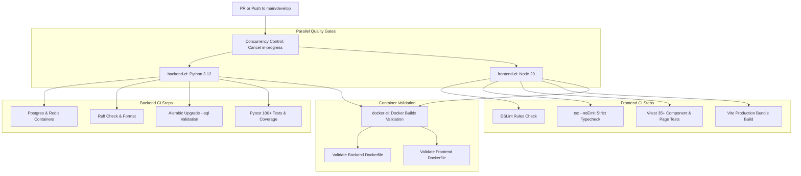

# CI/CD Automated Pipelines & Release Engineering — Developers Code Pulse (DCP)

## 1. Overview & Pipeline Philosophy

Developers Code Pulse (DCP) employs a robust **Continuous Integration (CI)** and **Continuous Deployment (CD)** pipeline built on **GitHub Actions**.

### Guiding Principles
1. **Quality Gates Before Merge**: Every pull request must satisfy linters, formatters, strict TypeScript compilation, migration validation, automated unit/integration tests, and Docker container build tests.
2. **Immutable Artifacts**: Production container images are tagged with the short Git commit SHA and pushed to GitHub Container Registry (`ghcr.io`).
3. **Least Privilege**: Actions specify explicit minimal permissions (`contents: read`, `packages: write`).
4. **Action Pinning**: Third-party GitHub Actions are pinned to full commit SHAs to prevent supply-chain tampering.

---

## 2. CI Pipeline Architecture (`.github/workflows/ci.yml`)

The CI workflow triggers on all pull requests and pushes to `main` and `develop`.

---

## 3. CD Deployment Pipeline Architecture (`.github/workflows/cd.yml`)

The CD workflow triggers upon pushes to the `main` branch after CI tests succeed.

### CD Steps
1. **Authentication**: Authenticates securely to GitHub Container Registry using `secrets.GITHUB_TOKEN`.
2. **Metadata Extraction**: Computes short commit SHA and `latest` tags.
3. **Multi-Stage Build**: Builds optimized multi-stage images with GitHub Actions caching (`type=gha`).
4. **Publish to Registry**:
   - `ghcr.io/dashwanth15/developers-code-pulse/backend:<sha>`
   - `ghcr.io/dashwanth15/developers-code-pulse/frontend:<sha>`
5. **Configuration Verification**: Validates production `docker-compose.prod.yml` syntax.

---

## 4. Branch Protection & Security Guidelines

To ensure deployment integrity, the `main` branch in the GitHub repository should have the following branch protection rules configured:
- Require a pull request before merging.
- Require status checks to pass before merging:
  - `backend-ci`
  - `frontend-ci`
  - `docker-ci`
- Require conversation resolution before merging.
- Disallow force pushes and deletions.
- Restrict write access to authenticated maintainers.
