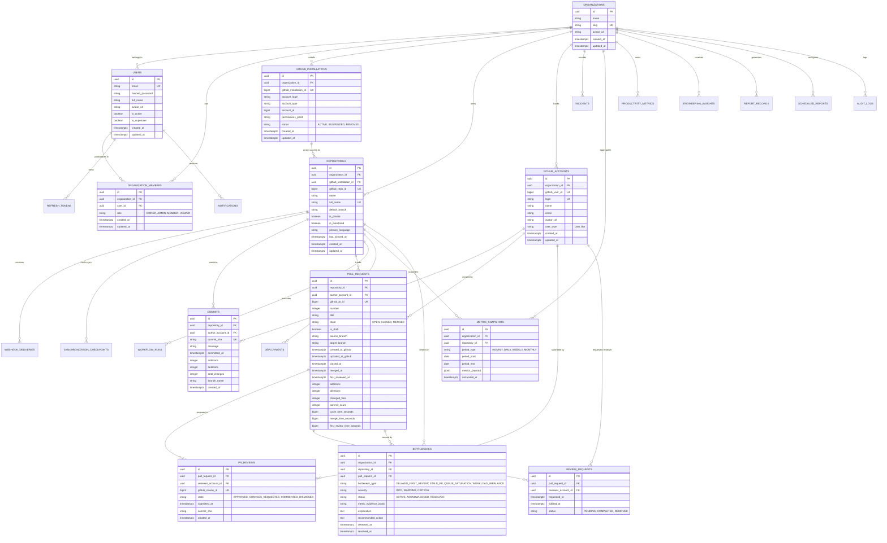

# DEVELOPERS CODE PULSE (DCP)
## Database Schema & Data Architecture Specification

---

## 1. Database Architecture Principles

Developers Code Pulse uses **PostgreSQL 16+** as its primary relational data store. The data architecture adheres to the following strict principles:

1. **Universally Unique Identifiers (UUIDv4 / UUIDv7):** All primary keys are UUIDs to prevent ID enumeration, support seamless distributed generation, and ease future data partitioning.
2. **Strict Multi-Tenant Isolation:** All organization-scoped data tables maintain an `organization_id` foreign key with `ON DELETE CASCADE`. API queries must enforce `organization_id` scoping in every WHERE clause.
3. **Rigorous UTC Timestamps:** All timestamp columns use PostgreSQL `TIMESTAMPTZ` (timestamp with time zone) and store UTC values exclusively. Client timezones are applied only in the presentation layer.
4. **Relational Integrity with Foreign Keys:** Strong foreign key constraints safeguard referential integrity across users, organizations, repositories, commits, pull requests, and reviews.
5. **Separation of Raw vs. Normalized Data:** Raw incoming webhook payloads are preserved in `webhook_deliveries` / `github_events` for auditability and replayability, while domain business logic operates strictly on typed, normalized tables (`pull_requests`, `commits`, `pr_reviews`).
6. **Pre-aggregated Metric Snapshots:** High-frequency dashboard queries read from pre-aggregated `metric_snapshots` rather than computing costly window aggregates over millions of raw event rows on each HTTP request.
7. **Constrained JSONB Usage:** JSONB is restricted to raw external metadata, dynamic rule configurations, and flexible third-party workflow payloads. Core domain relationships are always explicit relational columns.

---

## 2. Complete Entity-Relationship (ER) Diagram

---

## 3. Detailed Table Schema Definitions

### 3.1 Authentication & Multi-Tenancy

#### `organizations`
| Column | Type | Constraints | Description |
| :--- | :--- | :--- | :--- |
| `id` | `UUID` | Primary Key, default gen_random_uuid() | Unique organization identifier |
| `name` | `VARCHAR(255)` | NOT NULL | Human-readable organization name |
| `slug` | `VARCHAR(100)` | NOT NULL, UNIQUE, Indexed | URL-friendly unique slug |
| `avatar_url` | `VARCHAR(512)` | NULL | Optional logo URL |
| `created_at` | `TIMESTAMPTZ` | NOT NULL, default NOW() | Organization registration timestamp |
| `updated_at` | `TIMESTAMPTZ` | NOT NULL, default NOW() | Last update timestamp |

#### `users`
| Column | Type | Constraints | Description |
| :--- | :--- | :--- | :--- |
| `id` | `UUID` | Primary Key, default gen_random_uuid() | Unique user identifier |
| `email` | `VARCHAR(255)` | NOT NULL, UNIQUE, Indexed | Lowercase user email address |
| `hashed_password` | `VARCHAR(255)` | NOT NULL | Argon2id password hash |
| `full_name` | `VARCHAR(255)` | NOT NULL | Display name |
| `avatar_url` | `VARCHAR(512)` | NULL | Profile image URL |
| `is_active` | `BOOLEAN` | NOT NULL, default TRUE | Active account flag |
| `is_superuser` | `BOOLEAN` | NOT NULL, default FALSE | System administrator flag |
| `created_at` | `TIMESTAMPTZ` | NOT NULL, default NOW() | Creation timestamp |
| `updated_at` | `TIMESTAMPTZ` | NOT NULL, default NOW() | Update timestamp |

#### `organization_members`
| Column | Type | Constraints | Description |
| :--- | :--- | :--- | :--- |
| `id` | `UUID` | Primary Key, default gen_random_uuid() | Record ID |
| `organization_id`| `UUID` | NOT NULL, FK -> organizations.id ON DELETE CASCADE | Scoped organization |
| `user_id` | `UUID` | NOT NULL, FK -> users.id ON DELETE CASCADE | Member user |
| `role` | `VARCHAR(32)` | NOT NULL, default 'MEMBER' | Role: 'OWNER', 'ADMIN', 'MEMBER', 'VIEWER' |
| `created_at` | `TIMESTAMPTZ` | NOT NULL, default NOW() | Added timestamp |
| `updated_at` | `TIMESTAMPTZ` | NOT NULL, default NOW() | Role updated timestamp |
*Indexes:* Unique constraint on `(organization_id, user_id)`.

#### `refresh_tokens`
| Column | Type | Constraints | Description |
| :--- | :--- | :--- | :--- |
| `id` | `UUID` | Primary Key, default gen_random_uuid() | Token ID |
| `user_id` | `UUID` | NOT NULL, FK -> users.id ON DELETE CASCADE | Target user |
| `token_hash` | `VARCHAR(255)` | NOT NULL, UNIQUE, Indexed | SHA-256 hash of refresh token |
| `expires_at` | `TIMESTAMPTZ` | NOT NULL | Expiration timestamp |
| `revoked` | `BOOLEAN` | NOT NULL, default FALSE | Revocation status |
| `created_at` | `TIMESTAMPTZ` | NOT NULL, default NOW() | Issuance timestamp |

---

### 3.2 GitHub Integration & Webhooks

#### `github_installations`
| Column | Type | Constraints | Description |
| :--- | :--- | :--- | :--- |
| `id` | `UUID` | Primary Key, default gen_random_uuid() | Internal identifier |
| `organization_id`| `UUID` | NOT NULL, FK -> organizations.id ON DELETE CASCADE | Linked organization |
| `github_installation_id` | `BIGINT` | NOT NULL, UNIQUE, Indexed | GitHub App Installation ID |
| `account_login` | `VARCHAR(255)` | NOT NULL | GitHub organization or user account name |
| `account_type` | `VARCHAR(50)` | NOT NULL | 'Organization' or 'User' |
| `account_id` | `BIGINT` | NOT NULL | GitHub account ID |
| `permissions_jsonb` | `JSONB` | NOT NULL, default '{}' | Granted GitHub app permissions |
| `status` | `VARCHAR(32)` | NOT NULL, default 'ACTIVE' | 'ACTIVE', 'SUSPENDED', 'REMOVED' |
| `created_at` | `TIMESTAMPTZ` | NOT NULL, default NOW() | Installation timestamp |
| `updated_at` | `TIMESTAMPTZ` | NOT NULL, default NOW() | Status change timestamp |

#### `repositories`
| Column | Type | Constraints | Description |
| :--- | :--- | :--- | :--- |
| `id` | `UUID` | Primary Key, default gen_random_uuid() | Internal repository identifier |
| `organization_id`| `UUID` | NOT NULL, FK -> organizations.id ON DELETE CASCADE | Owning organization |
| `github_installation_id` | `UUID` | NOT NULL, FK -> github_installations.id ON DELETE CASCADE | Integration link |
| `github_repo_id`| `BIGINT` | NOT NULL, UNIQUE, Indexed | GitHub repository ID |
| `name` | `VARCHAR(255)` | NOT NULL | Repository name (e.g., 'dcp-api') |
| `full_name` | `VARCHAR(512)` | NOT NULL, UNIQUE, Indexed | Full name (e.g., 'org/dcp-api') |
| `default_branch` | `VARCHAR(100)` | NOT NULL, default 'main' | Primary branch |
| `is_private` | `BOOLEAN` | NOT NULL, default TRUE | Visibility |
| `is_monitored` | `BOOLEAN` | NOT NULL, default TRUE, Indexed | Whether analytics collection is enabled |
| `primary_language` | `VARCHAR(100)` | NULL | Primary programming language |
| `last_synced_at`| `TIMESTAMPTZ` | NULL | Last backfill / reconciliation run |
| `created_at` | `TIMESTAMPTZ` | NOT NULL, default NOW() | Added timestamp |
| `updated_at` | `TIMESTAMPTZ` | NOT NULL, default NOW() | Metadata update timestamp |

#### `github_accounts`
| Column | Type | Constraints | Description |
| :--- | :--- | :--- | :--- |
| `id` | `UUID` | Primary Key, default gen_random_uuid() | Internal identity |
| `organization_id`| `UUID` | NOT NULL, FK -> organizations.id ON DELETE CASCADE | Scoped organization |
| `github_user_id`| `BIGINT` | NOT NULL, Indexed | GitHub actor ID |
| `login` | `VARCHAR(255)` | NOT NULL, Indexed | GitHub username |
| `name` | `VARCHAR(255)` | NULL | Public name |
| `email` | `VARCHAR(255)` | NULL | Public email |
| `avatar_url` | `VARCHAR(512)` | NULL | Profile image URL |
| `user_type` | `VARCHAR(32)` | NOT NULL, default 'User' | 'User', 'Bot', 'Organization' |
| `created_at` | `TIMESTAMPTZ` | NOT NULL, default NOW() | First seen |
| `updated_at` | `TIMESTAMPTZ` | NOT NULL, default NOW() | Last seen |
*Indexes:* Unique constraint on `(organization_id, github_user_id)`.

#### `webhook_deliveries`
| Column | Type | Constraints | Description |
| :--- | :--- | :--- | :--- |
| `id` | `UUID` | Primary Key, default gen_random_uuid() | Record ID |
| `delivery_id` | `VARCHAR(100)` | NOT NULL, UNIQUE, Indexed | Value from X-GitHub-Delivery header |
| `event_type` | `VARCHAR(100)` | NOT NULL, Indexed | GitHub event header (e.g., 'pull_request') |
| `repository_id` | `UUID` | NULL, FK -> repositories.id ON DELETE SET NULL | Target repository if known |
| `payload` | `JSONB` | NOT NULL | Raw incoming event payload |
| `status` | `VARCHAR(32)` | NOT NULL, default 'PENDING' | 'PENDING', 'PROCESSED', 'FAILED', 'DUPLICATE' |
| `error_message` | `TEXT` | NULL | Processing failure reason if any |
| `received_at` | `TIMESTAMPTZ` | NOT NULL, default NOW() | Receipt timestamp |
| `processed_at` | `TIMESTAMPTZ` | NULL | Completion timestamp |

#### `synchronization_checkpoints`
| Column | Type | Constraints | Description |
| :--- | :--- | :--- | :--- |
| `id` | `UUID` | Primary Key, default gen_random_uuid() | Record ID |
| `repository_id` | `UUID` | NOT NULL, FK -> repositories.id ON DELETE CASCADE | Target repository |
| `entity_type` | `VARCHAR(50)` | NOT NULL | 'COMMITS', 'PULL_REQUESTS', 'WORKFLOWS' |
| `cursor_or_page`| `VARCHAR(255)` | NULL | Current pagination cursor / page |
| `last_event_timestamp` | `TIMESTAMPTZ` | NULL | High-water mark timestamp for incremental sync |
| `status` | `VARCHAR(32)` | NOT NULL, default 'IN_PROGRESS' | 'IN_PROGRESS', 'COMPLETED', 'FAILED' |
| `updated_at` | `TIMESTAMPTZ` | NOT NULL, default NOW() | Last sync step timestamp |
*Indexes:* Unique constraint on `(repository_id, entity_type)`.

---

### 3.3 Development Activity

#### `commits`
| Column | Type | Constraints | Description |
| :--- | :--- | :--- | :--- |
| `id` | `UUID` | Primary Key, default gen_random_uuid() | Record ID |
| `repository_id` | `UUID` | NOT NULL, FK -> repositories.id ON DELETE CASCADE, Indexed | Containing repository |
| `author_account_id` | `UUID` | NULL, FK -> github_accounts.id ON DELETE SET NULL, Indexed | Author account |
| `commit_sha` | `VARCHAR(40)` | NOT NULL, UNIQUE, Indexed | Git commit hash |
| `message` | `TEXT` | NOT NULL | Commit log message |
| `committed_at` | `TIMESTAMPTZ` | NOT NULL, Indexed | Git author timestamp |
| `additions` | `INTEGER` | NOT NULL, default 0 | Lines added |
| `deletions` | `INTEGER` | NOT NULL, default 0 | Lines removed |
| `total_changes` | `INTEGER` | NOT NULL, default 0 | Total lines changed |
| `branch_name` | `VARCHAR(255)` | NULL, Indexed | Branch name |
| `created_at` | `TIMESTAMPTZ` | NOT NULL, default NOW() | Ingestion timestamp |
*Indexes:* Compound index on `(repository_id, committed_at)`.

#### `pull_requests`
| Column | Type | Constraints | Description |
| :--- | :--- | :--- | :--- |
| `id` | `UUID` | Primary Key, default gen_random_uuid() | Record ID |
| `repository_id` | `UUID` | NOT NULL, FK -> repositories.id ON DELETE CASCADE, Indexed | Scoped repository |
| `author_account_id` | `UUID` | NULL, FK -> github_accounts.id ON DELETE SET NULL, Indexed | PR author |
| `github_pr_id` | `BIGINT` | NOT NULL, UNIQUE, Indexed | GitHub PR ID |
| `number` | `INTEGER` | NOT NULL | PR number within repository |
| `title` | `VARCHAR(512)` | NOT NULL | PR title |
| `state` | `VARCHAR(32)` | NOT NULL, default 'OPEN', Indexed | 'OPEN', 'CLOSED', 'MERGED' |
| `is_draft` | `BOOLEAN` | NOT NULL, default FALSE, Indexed | Draft status |
| `source_branch` | `VARCHAR(255)` | NOT NULL | Head branch |
| `target_branch` | `VARCHAR(255)` | NOT NULL | Base branch |
| `created_at_github` | `TIMESTAMPTZ` | NOT NULL, Indexed | PR creation time on GitHub |
| `updated_at_github` | `TIMESTAMPTZ` | NOT NULL | Last update on GitHub |
| `closed_at` | `TIMESTAMPTZ` | NULL, Indexed | When PR was closed |
| `merged_at` | `TIMESTAMPTZ` | NULL, Indexed | When PR was merged |
| `first_reviewed_at` | `TIMESTAMPTZ` | NULL, Indexed | Timestamp of first qualifying review |
| `additions` | `INTEGER` | NOT NULL, default 0 | Lines added |
| `deletions` | `INTEGER` | NOT NULL, default 0 | Lines deleted |
| `changed_files` | `INTEGER` | NOT NULL, default 0 | Number of modified files |
| `commit_count` | `INTEGER` | NOT NULL, default 0 | Number of commits in PR |
| `cycle_time_seconds` | `BIGINT` | NULL | Duration from first commit to merge |
| `merge_time_seconds` | `BIGINT` | NULL | Duration from PR creation to merge |
| `first_review_time_seconds` | `BIGINT` | NULL | Duration from PR creation to first review |
| `created_at` | `TIMESTAMPTZ` | NOT NULL, default NOW() | Ingestion timestamp |
*Indexes:* Compound index on `(repository_id, state, created_at_github)`. Compound index on `(repository_id, merged_at)`.

#### `pr_reviews`
| Column | Type | Constraints | Description |
| :--- | :--- | :--- | :--- |
| `id` | `UUID` | Primary Key, default gen_random_uuid() | Record ID |
| `pull_request_id` | `UUID` | NOT NULL, FK -> pull_requests.id ON DELETE CASCADE, Indexed | Target PR |
| `reviewer_account_id`| `UUID` | NULL, FK -> github_accounts.id ON DELETE SET NULL, Indexed | Reviewer account |
| `github_review_id`| `BIGINT` | NOT NULL, UNIQUE, Indexed | GitHub review ID |
| `state` | `VARCHAR(32)` | NOT NULL | 'APPROVED', 'CHANGES_REQUESTED', 'COMMENTED', 'DISMISSED' |
| `submitted_at` | `TIMESTAMPTZ` | NOT NULL, Indexed | Review submission timestamp |
| `commit_sha` | `VARCHAR(40)` | NULL | Commit reviewed |
| `created_at` | `TIMESTAMPTZ` | NOT NULL, default NOW() | Ingestion timestamp |
*Indexes:* Compound index on `(pull_request_id, submitted_at)`.

#### `review_requests`
| Column | Type | Constraints | Description |
| :--- | :--- | :--- | :--- |
| `id` | `UUID` | Primary Key, default gen_random_uuid() | Record ID |
| `pull_request_id` | `UUID` | NOT NULL, FK -> pull_requests.id ON DELETE CASCADE, Indexed | Target PR |
| `reviewer_account_id`| `UUID` | NOT NULL, FK -> github_accounts.id ON DELETE CASCADE, Indexed | Requested reviewer |
| `requested_at` | `TIMESTAMPTZ` | NOT NULL, default NOW() | When review was requested |
| `fulfilled_at` | `TIMESTAMPTZ` | NULL | When reviewer submitted their review |
| `status` | `VARCHAR(32)` | NOT NULL, default 'PENDING', Indexed | 'PENDING', 'COMPLETED', 'REMOVED' |

#### `workflow_runs` (CI/CD Pipeline Events)
| Column | Type | Constraints | Description |
| :--- | :--- | :--- | :--- |
| `id` | `UUID` | Primary Key, default gen_random_uuid() | Record ID |
| `repository_id` | `UUID` | NOT NULL, FK -> repositories.id ON DELETE CASCADE, Indexed | Scoped repository |
| `github_run_id` | `BIGINT` | NOT NULL, UNIQUE, Indexed | GitHub Actions run ID |
| `workflow_name` | `VARCHAR(255)` | NOT NULL, Indexed | Workflow name (e.g., 'CI') |
| `head_branch` | `VARCHAR(255)` | NOT NULL | Branch triggered |
| `head_sha` | `VARCHAR(40)` | NOT NULL | Commit SHA |
| `status` | `VARCHAR(50)` | NOT NULL | 'queued', 'in_progress', 'completed' |
| `conclusion` | `VARCHAR(50)` | NULL, Indexed | 'success', 'failure', 'cancelled', 'timed_out' |
| `started_at` | `TIMESTAMPTZ` | NOT NULL | Run start timestamp |
| `completed_at` | `TIMESTAMPTZ` | NULL | Run completion timestamp |
| `duration_seconds` | `INTEGER` | NULL | Runtime duration |

#### `deployments` (DORA Deployment Tracking)
| Column | Type | Constraints | Description |
| :--- | :--- | :--- | :--- |
| `id` | `UUID` | Primary Key, default gen_random_uuid() | Record ID |
| `repository_id` | `UUID` | NOT NULL, FK -> repositories.id ON DELETE CASCADE, Indexed | Scoped repository |
| `github_deployment_id`| `BIGINT` | NULL, UNIQUE, Indexed | GitHub deployment ID (if from GH) |
| `environment` | `VARCHAR(100)` | NOT NULL, Indexed | 'production', 'staging', etc. |
| `commit_sha` | `VARCHAR(40)` | NOT NULL, Indexed | Released commit SHA |
| `status` | `VARCHAR(50)` | NOT NULL, default 'SUCCESS', Indexed | 'SUCCESS', 'FAILURE', 'IN_PROGRESS' |
| `deployed_at` | `TIMESTAMPTZ` | NOT NULL, Indexed | Deployment timestamp |
| `created_at` | `TIMESTAMPTZ` | NOT NULL, default NOW() | Record creation |

#### `incidents` (DORA MTTR / CFR Tracking)
| Column | Type | Constraints | Description |
| :--- | :--- | :--- | :--- |
| `id` | `UUID` | Primary Key, default gen_random_uuid() | Record ID |
| `organization_id`| `UUID` | NOT NULL, FK -> organizations.id ON DELETE CASCADE, Indexed | Scoped organization |
| `repository_id` | `UUID` | NULL, FK -> repositories.id ON DELETE SET NULL, Indexed | Associated repository |
| `deployment_id` | `UUID` | NULL, FK -> deployments.id ON DELETE SET NULL | Linked deployment that caused incident |
| `title` | `VARCHAR(255)` | NOT NULL | Incident title |
| `severity` | `VARCHAR(32)` | NOT NULL, default 'MAJOR' | 'CRITICAL', 'MAJOR', 'MINOR' |
| `status` | `VARCHAR(32)` | NOT NULL, default 'RESOLVED' | 'TRIGGERED', 'ACKNOWLEDGED', 'RESOLVED' |
| `started_at` | `TIMESTAMPTZ` | NOT NULL, Indexed | Outage start timestamp |
| `resolved_at` | `TIMESTAMPTZ` | NULL, Indexed | Recovery timestamp |
| `time_to_restore_seconds` | `BIGINT` | NULL | Outage duration in seconds (MTTR element) |

---

### 3.4 Analytics & Intelligence

#### `metric_snapshots`
| Column | Type | Constraints | Description |
| :--- | :--- | :--- | :--- |
| `id` | `UUID` | Primary Key, default gen_random_uuid() | Record ID |
| `organization_id`| `UUID` | NOT NULL, FK -> organizations.id ON DELETE CASCADE, Indexed | Scoped organization |
| `repository_id` | `UUID` | NULL, FK -> repositories.id ON DELETE CASCADE, Indexed | Scoped repository (NULL = Org-wide) |
| `period_type` | `VARCHAR(32)` | NOT NULL, Indexed | 'DAILY', 'WEEKLY', 'MONTHLY' |
| `period_start` | `DATE` | NOT NULL, Indexed | Window start date |
| `period_end` | `DATE` | NOT NULL, Indexed | Window end date |
| `metrics_payload`| `JSONB` | NOT NULL | Aggregated metrics (means, medians, percentiles) |
| `calculated_at` | `TIMESTAMPTZ` | NOT NULL, default NOW() | Computation timestamp |
*Indexes:* Unique constraint on `(organization_id, repository_id, period_type, period_start)`.

#### `productivity_metrics` (Team-level Aggregates)
| Column | Type | Constraints | Description |
| :--- | :--- | :--- | :--- |
| `id` | `UUID` | Primary Key, default gen_random_uuid() | Record ID |
| `organization_id`| `UUID` | NOT NULL, FK -> organizations.id ON DELETE CASCADE, Indexed | Scoped organization |
| `repository_id` | `UUID` | NULL, FK -> repositories.id ON DELETE CASCADE, Indexed | Scoped repository |
| `window_days` | `INTEGER` | NOT NULL | 7, 14, 30, or 90 days |
| `total_commits` | `INTEGER` | NOT NULL, default 0 | Commit volume |
| `total_prs_opened`| `INTEGER` | NOT NULL, default 0 | PR creation count |
| `total_prs_merged`| `INTEGER` | NOT NULL, default 0 | PR merge count |
| `median_first_review_seconds` | `BIGINT` | NULL | Median TTFR |
| `median_merge_time_seconds` | `BIGINT` | NULL | Median PR merge latency |
| `median_cycle_time_seconds` | `BIGINT` | NULL | Median commit-to-merge time |
| `review_coverage_rate` | `DECIMAL(5,2)`| NULL | % of PRs receiving >=1 review |
| `snapshot_date` | `DATE` | NOT NULL, Indexed | Calculation date |

#### `bottlenecks`
| Column | Type | Constraints | Description |
| :--- | :--- | :--- | :--- |
| `id` | `UUID` | Primary Key, default gen_random_uuid() | Record ID |
| `organization_id`| `UUID` | NOT NULL, FK -> organizations.id ON DELETE CASCADE, Indexed | Scoped organization |
| `repository_id` | `UUID` | NOT NULL, FK -> repositories.id ON DELETE CASCADE, Indexed | Related repository |
| `pull_request_id` | `UUID` | NULL, FK -> pull_requests.id ON DELETE CASCADE, Indexed | Related PR (if applicable) |
| `bottleneck_type`| `VARCHAR(64)` | NOT NULL, Indexed | e.g., 'DELAYED_FIRST_REVIEW', 'STALE_PR' |
| `severity` | `VARCHAR(32)` | NOT NULL, Indexed | 'INFO', 'WARNING', 'CRITICAL' |
| `status` | `VARCHAR(32)` | NOT NULL, default 'ACTIVE', Indexed | 'ACTIVE', 'ACKNOWLEDGED', 'RESOLVED' |
| `metric_evidence`| `JSONB` | NOT NULL | Exact numbers triggering detection |
| `explanation` | `TEXT` | NOT NULL | Transparent explanation |
| `recommended_action`| `TEXT` | NOT NULL | Actionable next step |
| `detected_at` | `TIMESTAMPTZ` | NOT NULL, default NOW(), Indexed | Detection timestamp |
| `resolved_at` | `TIMESTAMPTZ` | NULL | When condition cleared |

#### `engineering_insights` (AI & Rule Summaries)
| Column | Type | Constraints | Description |
| :--- | :--- | :--- | :--- |
| `id` | `UUID` | Primary Key, default gen_random_uuid() | Record ID |
| `organization_id`| `UUID` | NOT NULL, FK -> organizations.id ON DELETE CASCADE, Indexed | Scoped organization |
| `repository_id` | `UUID` | NULL, FK -> repositories.id ON DELETE CASCADE | Target repository |
| `category` | `VARCHAR(64)` | NOT NULL | 'WEEKLY_SUMMARY', 'REVIEW_HEALTH', 'BOTTLENECK' |
| `title` | `VARCHAR(255)` | NOT NULL | Insight header |
| `summary` | `TEXT` | NOT NULL | Grounded markdown summary |
| `grounding_data` | `JSONB` | NOT NULL | References to snapshot IDs and metric data used |
| `is_ai_generated`| `BOOLEAN` | NOT NULL, default FALSE | Origin flag |
| `created_at` | `TIMESTAMPTZ` | NOT NULL, default NOW() | Generation timestamp |

#### `report_records`
| Column | Type | Constraints | Description |
| :--- | :--- | :--- | :--- |
| `id` | `UUID` | Primary Key, default gen_random_uuid() | Record ID |
| `organization_id`| `UUID` | NOT NULL, FK -> organizations.id ON DELETE CASCADE, Indexed | Scoped organization |
| `title` | `VARCHAR(255)` | NOT NULL | Report title |
| `report_type` | `VARCHAR(32)` | NOT NULL | 'WEEKLY', 'MONTHLY', 'DORA', 'CUSTOM' |
| `format` | `VARCHAR(16)` | NOT NULL | 'PDF', 'CSV', 'JSON' |
| `storage_url` | `VARCHAR(512)` | NOT NULL | S3 or local storage URL |
| `period_start` | `DATE` | NOT NULL | Report start window |
| `period_end` | `DATE` | NOT NULL | Report end window |
| `created_at` | `TIMESTAMPTZ` | NOT NULL, default NOW() | Export generation timestamp |

---

### 3.5 Administration & Operations

#### `scheduled_reports`
| Column | Type | Constraints | Description |
| :--- | :--- | :--- | :--- |
| `id` | `UUID` | Primary Key, default gen_random_uuid() | Record ID |
| `organization_id`| `UUID` | NOT NULL, FK -> organizations.id ON DELETE CASCADE, Indexed | Scoped organization |
| `report_type` | `VARCHAR(32)` | NOT NULL | 'WEEKLY', 'MONTHLY' |
| `cron_expression`| `VARCHAR(64)` | NOT NULL | Cron trigger schedule |
| `recipients_jsonb`| `JSONB` | NOT NULL | Array of recipient emails |
| `is_active` | `BOOLEAN` | NOT NULL, default TRUE | Active schedule toggle |
| `created_at` | `TIMESTAMPTZ` | NOT NULL, default NOW() | Creation timestamp |

#### `notifications`
| Column | Type | Constraints | Description |
| :--- | :--- | :--- | :--- |
| `id` | `UUID` | Primary Key, default gen_random_uuid() | Record ID |
| `user_id` | `UUID` | NOT NULL, FK -> users.id ON DELETE CASCADE, Indexed | Target user |
| `organization_id`| `UUID` | NOT NULL, FK -> organizations.id ON DELETE CASCADE | Scoped organization |
| `title` | `VARCHAR(255)` | NOT NULL | Alert title |
| `message` | `TEXT` | NOT NULL | Notification body |
| `link_url` | `VARCHAR(512)` | NULL | Deep link to UI |
| `is_read` | `BOOLEAN` | NOT NULL, default FALSE, Indexed | Read status |
| `created_at` | `TIMESTAMPTZ` | NOT NULL, default NOW(), Indexed | Timestamp |

#### `audit_logs`
| Column | Type | Constraints | Description |
| :--- | :--- | :--- | :--- |
| `id` | `UUID` | Primary Key, default gen_random_uuid() | Record ID |
| `organization_id`| `UUID` | NOT NULL, FK -> organizations.id ON DELETE CASCADE, Indexed | Scoped organization |
| `actor_user_id` | `UUID` | NULL, FK -> users.id ON DELETE SET NULL, Indexed | Acting user |
| `action` | `VARCHAR(100)` | NOT NULL, Indexed | e.g., 'REPO_MONITORING_TOGGLED', 'USER_ROLE_UPDATED' |
| `resource_type` | `VARCHAR(100)` | NOT NULL | Target entity type |
| `resource_id` | `VARCHAR(255)` | NULL | Target entity identifier |
| `metadata_jsonb` | `JSONB` | NOT NULL, default '{}' | Contextual changes diff |
| `ip_address` | `VARCHAR(45)` | NULL | Client IP address |
| `created_at` | `TIMESTAMPTZ` | NOT NULL, default NOW(), Indexed | Event log timestamp |

---

## 4. Database Relationship Explanations & Referential Integrity

1. **Multi-Tenant Foundation:**
   - Every user belongs to one or more organizations through `organization_members`.
   - All assets (installations, repositories, accounts, metrics, reports, audit logs) belong directly to an `organization_id`.
   - Cascade rules ensure when an organization is deleted, all member associations, installations, repositories, and metrics are cleanly purged without orphan records.
2. **GitHub Account Disambiguation:**
   - `github_accounts` acts as an organizational identity index for GitHub users and bots.
   - PR authors, commit authors, review request targets, and review submitters all reference `github_accounts.id`. This ensures GitHub accounts are not conflated with DCP system user logins unless explicitly linked.
3. **Pull Request Lifecycle Normalization:**
   - A single `pull_requests` record represents the current state of a PR.
   - Detailed review actions are stored in `pr_reviews`, recording individual approvals, change requests, and comments.
   - Pending reviewer assignments are maintained in `review_requests`.
   - Denormalized aggregate metrics on `pull_requests` (`first_review_time_seconds`, `merge_time_seconds`, `cycle_time_seconds`) are recalculated on review/merge events to enable ultra-fast index scans without joining `pr_reviews` for basic lifecycle queries.
4. **Bottleneck Audit Trail:**
   - A `bottlenecks` record connects the detected issue to both the `organization_id` and `repository_id`, with an optional reference to the offending `pull_request_id`.
   - When a PR is merged or reviewed, the bottleneck status transitions to `RESOLVED` with `resolved_at` set to provide clear retrospective evidence.
