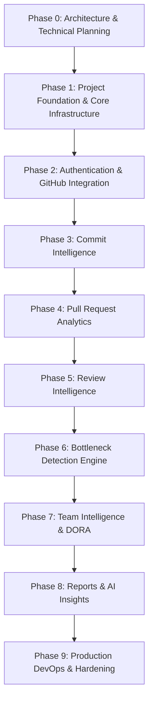

# DEVELOPERS CODE PULSE (DCP)
## Development Roadmap & Execution Strategy

---

## 1. Master Phased Implementation Roadmap

Developers Code Pulse is implemented systematically across 10 disciplined phases (Phase 0 through Phase 9). No phase is bypassed or marked complete without automated verification.

---

## 2. Phase-by-Phase Milestones & Deliverables

### Phase 0: Architecture & Technical Planning (Current Phase)
- **Objective:** Establish airtight system, database, API, webhook, analytics, DevOps, and security specifications.
- **Key Deliverables:** 10 core architecture specification documents, Mermaid diagrams, threat model, metric catalogue.
- **Verification:** Architectural peer review, schema validation, and alignment check against all master prompt requirements.

### Phase 1: Project Foundation & Core Infrastructure
- **Objective:** Scaffold independent standalone repository, FastAPI backend, React SPA frontend, PostgreSQL, Redis, Celery, and Docker Compose.
- **Key Deliverables:**
  - `backend/`: FastAPI app, Pydantic settings, SQLAlchemy async engine, Alembic migrations, health probes (`/health`, `/ready`).
  - `frontend/`: React 18, Vite, TypeScript, Tailwind CSS, shadcn/ui components, router shell, theme provider.
  - `infrastructure/`: `docker-compose.yml`, Dockerfiles, `.env.example`.
  - `.github/workflows/ci.yml`: Initial linting and test pipeline.
- **Verification:** `docker compose up` starts all 8 services in healthy state; initial pytest and Vitest runs pass.

### Phase 2: Authentication & GitHub Integration
- **Objective:** Multi-tenant user auth, organization management, GitHub App setup, webhook ingestion with HMAC-SHA256 signature verification.
- **Key Deliverables:**
  - Auth services: Argon2id password hashing, JWT issuance, refresh token rotation, RBAC dependencies.
  - GitHub App integration: App JWT creation, installation token caching in Redis, `/integrations/github/webhooks` endpoint.
  - Webhook delivery logging & idempotency with Redis/Celery queue handoff.
- **Verification:** Integration tests verifying valid signature acceptance (202), invalid signature rejection (401), and duplicate delivery idempotency (200).

### Phase 3: Commit Intelligence
- **Objective:** Commit event ingestion, author resolution, and historical cadence analysis.
- **Key Deliverables:**
  - Ingestion of GitHub `push` events and commit metadata.
  - `commits` table storage, compound index optimizations.
  - API endpoints: `GET /repositories/{id}/commits`, `GET /analytics/commits`.
  - Frontend charts: Commit activity timeline and repository comparison.
- **Verification:** Synthetic commit batch ingestion verifies correct author aggregation and cadence calculations.

### Phase 4: Pull Request Analytics
- **Objective:** End-to-end PR lifecycle tracking, cycle time, and merge latency calculations.
- **Key Deliverables:**
  - Normalization of `pull_request` events (`opened`, `closed`, `reopened`, `draft`).
  - Calculation logic for $T_{\text{merge}}$ and $T_{\text{cycle}}$.
  - API endpoint: `GET /analytics/pull-requests`.
  - Frontend: PR volume trends, merge rate indicator, PR size distribution cards.
- **Verification:** Tests for draft PR exclusion, squash merge cycle calculation, and unmerged PR closure.

### Phase 5: Review Intelligence (Signature Module)
- **Objective:** Deep tracking of peer code reviews, Time to First Review (TTFR), approval turnaround, and reviewer workload distribution.
- **Key Deliverables:**
  - Normalization of `pull_request_review` and `review_requests`.
  - TTFR algorithm with author self-review exclusion.
  - Reviewer workload index and Gini coefficient calculations.
  - Real-time pending review queue endpoint (`GET /analytics/reviews/pending`).
  - Frontend Review Intelligence dashboard with histogram and workload balance matrix.
- **Verification:** Tests asserting correct first review capture and reviewer distribution calculation.

### Phase 6: Bottleneck Detection Engine (Signature Module)
- **Objective:** Deterministic, rule-based detection of engineering workflow friction points.
- **Key Deliverables:**
  - Rule evaluation engine (`DELAYED_FIRST_REVIEW`, `STALE_PR`, `QUEUE_SATURATION`, `WORKLOAD_CONCENTRATION`).
  - Automated generation of metric evidence and actionable recommendations.
  - API endpoints: `GET /bottlenecks`, `PATCH /bottlenecks/{id}`.
  - Frontend Bottleneck Radar with severity badges and direct PR deep-linking.
- **Verification:** Unit tests verifying rules trigger precisely at configured thresholds and auto-resolve upon review.

### Phase 7: Team Intelligence & DORA Metrics
- **Objective:** Cross-repository team collaboration trends and four DORA delivery metrics.
- **Key Deliverables:**
  - Team-level review matrix and collaboration graph.
  - DORA calculations (Deployment Frequency, Lead Time for Changes, CFR, MTTR).
  - Explicit data source validation: honest "Insufficient Data" states when deployment/incident data is absent.
  - Frontend DORA dashboard with industry performance tier classifications.
- **Verification:** Tests asserting DORA returns `INSUFFICIENT_DATA` when incidents are missing instead of faking 0%.

### Phase 8: Reports & Grounded AI Insights
- **Objective:** Automated weekly/monthly retrospectives and grounded AI narrative summaries.
- **Key Deliverables:**
  - Async PDF, CSV, and JSON report generator via Celery worker.
  - AI workflow summary engine strictly grounded in stored metric snapshots (zero metric hallucination).
  - Celery Beat scheduled report triggers and user notifications.
- **Verification:** Tests asserting AI prompt generation rejects hallucinated numbers and formats grounded citations.

### Phase 9: Production DevOps, Hardening & Final QA
- **Objective:** Production container optimization, security hardening, complete GitHub Actions workflows, and E2E verification.
- **Key Deliverables:**
  - Production multi-stage Docker builds with Trivy vulnerability scanning.
  - Complete 7 GitHub Actions workflows.
  - Prometheus + Grafana production monitoring dashboards.
  - End-to-end Playwright test suite covering complete user journeys.
- **Verification:** Zero critical/high CVEs, clean Playwright E2E run, and validated health check rolling deployment.

---

## 3. Agent Responsibility Matrix

To maintain clean separation of concerns and avoid merge conflicts, work streams are mapped to defined agent roles:

| Agent Role | Primary Responsibilities & File Ownership |
| :--- | :--- |
| **ARCHITECT AGENT** | System architecture, database schema migrations, shared API schemas (`app/schemas/`), architectural consistency reviews. |
| **BACKEND AGENT** | FastAPI routers (`app/api/v1/`), database models (`app/models/`), authentication & RBAC (`app/services/auth/`), core business services. |
| **GITHUB INTEGRATION AGENT** | GitHub App JWT handling, installation token management, webhook signature verification, event normalization (`app/services/github/`). |
| **ANALYTICS AGENT** | Statistical calculations, metric formulas, bottleneck rules engine, snapshot aggregation (`app/services/analytics/`). |
| **FRONTEND AGENT** | React 18 SPA, Tailwind CSS styles, shadcn/ui components, Recharts visualizations, TanStack Query hooks, UI state handling. |
| **DEVOPS AGENT** | Dockerfiles, Docker Compose configurations, GitHub Actions workflows (`.github/workflows/`), Prometheus, Grafana. |
| **QA AGENT** | Pytest suites, mock webhook generators, Vitest component tests, Playwright E2E suites, security vulnerability audits. |

---

## 4. Risk Register & Mitigation Strategy

| Risk ID | Identified Risk | Impact | Probability | Mitigation Strategy |
| :--- | :--- | :---: | :---: | :--- |
| **R-01** | **GitHub API Secondary Rate Limits:** High volume backfill triggers 403 secondary rate limits. | High | Medium | Implement GraphQL query batching, token pooling, and jittered exponential backoff honoring `Retry-After`. |
| **R-02** | **Duplicate Webhook Delivery:** Network retries cause double-counting of commits or reviews. | High | High | Enforce database unique constraint on `delivery_id` in `webhook_deliveries`; check before enqueuing to Celery. |
| **R-03** | **Heavy Live Query Latency:** Live analytical aggregation over 100k+ commits causes dashboard timeouts. | High | Medium | Never aggregate raw events during user HTTP queries; read exclusively from pre-aggregated `metric_snapshots`. |
| **R-04** | **AI Metric Hallucination:** LLM invents nonexistent review delays or PR numbers. | Critical | Low | Strictly pass pre-calculated metrics as structured JSON in the prompt; enforce verification that all cited numbers exist in the snapshot. |
| **R-05** | **Cross-Tenant Data Leak:** Flawed query exposes one organization's PR data to another. | Critical | Low | Enforce mandatory `organization_id` filtering via FastAPI dependency injection and database foreign key cascades. |
