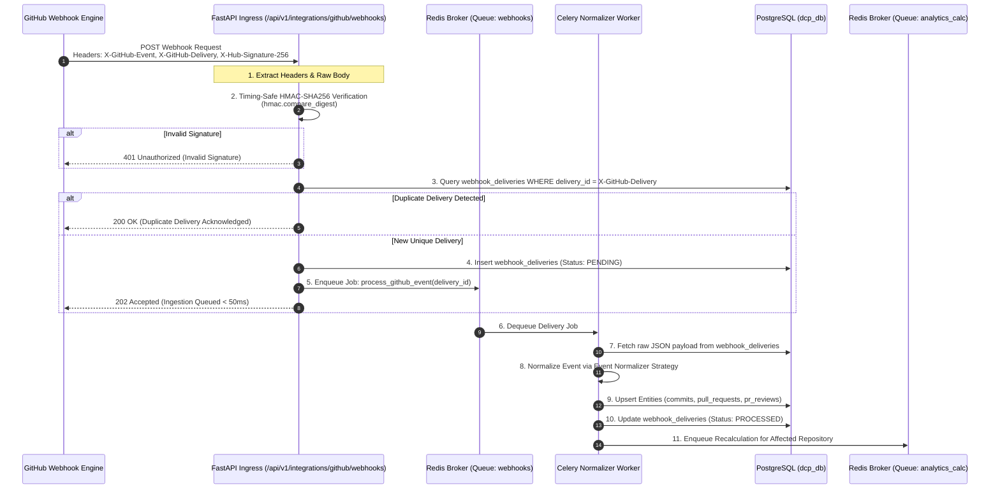

# DEVELOPERS CODE PULSE (DCP)
## GitHub Integration Architecture & Webhook Ingestion

---

## 1. Integration Strategy: GitHub App vs OAuth App

Developers Code Pulse (DCP) integrates with GitHub strictly as a **GitHub App** rather than a legacy OAuth App.

```
+------------------------------------------------------------------------------------+
| EVALUATION CRITERIA       | GITHUB APP (DCP CHOICE)       | OAUTH APP (REJECTED)   |
+---------------------------+-------------------------------+------------------------+
| Permission Granularity    | Fine-grained (per-repo, read) | Broad, all-or-nothing  |
| Identity & Ownership      | Owned by Organization         | Tied to single user    |
| Token Lifespan            | 1-Hour short-lived tokens     | Indefinite lifespan    |
| Webhook Support           | Built-in centralized webhooks | Requires repo config   |
| Rate Limits               | 5,000 to 12,500 req/hr        | 5,000 req/hr per user  |
| Security & Compliance     | Enterprise SOC2 ready         | High-risk user leakage |
+------------------------------------------------------------------------------------+
```

### GitHub App Permission Manifest (Principle of Least Privilege)
DCP requests the absolute minimum permissions necessary to calculate workflow intelligence:

| Scope | Permission Level | Justification |
| :--- | :--- | :--- |
| **Pull Requests** | Read-Only | Required to track PR creation, lifecycle, commits, changes, and reviews. |
| **Contents** | Read-Only | Required to inspect commit messages and commit timestamps on branches. |
| **Metadata** | Read-Only | Mandatory default for GitHub Apps to read basic repository names. |
| **Actions** | Read-Only | Required to track workflow runs for CI/CD latency and build outcomes. |
| **Deployments** | Read-Only | Required to record deployment events to staging and production (DORA). |

*Note:* DCP **never** requests write permissions to code, pull requests, issues, or organization settings.

---

## 2. GitHub Webhook Event-Flow Diagram



---

## 3. Supported Webhook Events & Payload Handling

DCP subscribes exclusively to relevant workflow lifecycle events:

### 3.1 `pull_request`
- **Actions Monitored:** `opened`, `closed`, `reopened`, `edited`, `review_requested`, `review_request_removed`, `ready_for_review`, `converted_to_draft`.
- **Entity Updates:**
  - `opened`: Insert `pull_requests` record with `created_at_github`.
  - `converted_to_draft` / `ready_for_review`: Update `is_draft` flag. (Draft PRs are excluded from Time to First Review calculations until marked ready).
  - `closed`: If `merged == true`, record `merged_at`, compute `merge_time_seconds` and `cycle_time_seconds`. If `merged == false`, mark as unmerged closed.
  - `review_requested`: Upsert `review_requests` record with status `PENDING`.

### 3.2 `pull_request_review`
- **Actions Monitored:** `submitted`, `dismissed`, `edited`.
- **Entity Updates:**
  - `submitted`: Upsert `pr_reviews`.
  - Check if this is the PR's first qualifying review (state in `APPROVED`, `CHANGES_REQUESTED`, `COMMENTED`).
  - If `first_reviewed_at` is null on `pull_requests` and review author != PR author:
    - Set `first_reviewed_at = submitted_at`.
    - Compute `first_review_time_seconds = submitted_at - created_at_github`.
  - Fulfill matching `review_requests` record (`status = COMPLETED`).

### 3.3 `pull_request_review_comment` & `pull_request_review_thread`
- **Actions Monitored:** `created`, `resolved`.
- **Entity Updates:** Increments review conversation depth and tracks unresolved review comments contributing to PR cycle delays.

### 3.4 `push`
- **Actions Monitored:** Default branch pushes and monitored feature branch pushes.
- **Entity Updates:** Upsert `commits` records (SHA, message, timestamp, additions, deletions) and associate with `github_accounts`.

### 3.5 `workflow_run`
- **Actions Monitored:** `completed`.
- **Entity Updates:** Upsert `workflow_runs` to monitor CI test latency, pass/fail rates, and pipeline stability.

### 3.6 `deployment` and `deployment_status`
- **Actions Monitored:** `created`.
- **Entity Updates:** Record production deployments for DORA Deployment Frequency and Lead Time for Changes calculations.

### 3.7 `installation` and `installation_repositories`
- **Actions Monitored:** `created`, `deleted`, `added`, `removed`.
- **Entity Updates:** Synchronize active repository monitoring inventory and installation status.

---

## 4. Webhook Security & Verification Algorithm

```python
import hmac
import hashlib

def verify_github_signature(
    raw_payload_bytes: bytes, 
    secret_token: str, 
    signature_header: str | None
) -> bool:
    """
    Cryptographically verify GitHub webhook payload using HMAC-SHA256.
    Uses timing-safe comparison to prevent side-channel timing attacks.
    """
    if not signature_header or not signature_header.startswith("sha256="):
        return False
    
    expected_hash = signature_header.split("sha256=")[1]
    computed_hmac = hmac.new(
        key=secret_token.encode("utf-8"),
        msg=raw_payload_bytes,
        digestmod=hashlib.sha256
    )
    
    return hmac.compare_digest(computed_hmac.hexdigest(), expected_hash)
```

---

## 5. Event Normalization Rules & Edge Case Handling

1. **Draft Pull Requests:**
   - Many developers open PRs as drafts early in development.
   - *Rule:* The clock for **Time to First Review (TTFR)** does **not** begin when the draft PR is created. It starts when `action == ready_for_review`. If a PR was never a draft, it starts at `created_at_github`.
2. **Self-Reviews and Author Comments:**
   - Authors often leave clarifying comments on their own PRs.
   - *Rule:* Self-reviews or comments made by the PR author do **not** qualify as a first review. First qualifying review requires `reviewer_account_id != author_account_id`.
3. **Squash and Rebase Merges:**
   - GitHub creates a synthetic merge commit on squash merges.
   - *Rule:* PR cycle time is calculated using the timestamp of the author's **first original commit** on the branch, not the final squash commit timestamp.
4. **Reopened Pull Requests:**
   - If a closed PR is reopened, cycle time tracking resumes. The duration during which the PR remained closed is deducted from net active cycle time.
5. **Abandoned Pull Requests:**
   - PRs closed without merge are categorized as `CLOSED_UNMERGED`. They are excluded from merge-time averages to prevent skewing successful delivery metrics, but tracked in PR abandonment rate.

---

## 6. Rate Limiting, Token Management, and GitHub API Backoff

### 6.1 GitHub App Installation Token Lifecycle
- GitHub App tokens expire after 60 minutes.
- DCP generates an App JWT (signed with the App's RSA Private Key, 10-minute expiry) to request an Installation Access Token from `/app/installations/{installation_id}/access_tokens`.
- Installation tokens are cached in Redis with a TTL of **50 minutes** (refreshing 10 minutes prior to expiration).

### 6.2 Rate Limit Mitigation & Exponential Backoff
- GitHub grants 5,000 requests/hour per installation (up to 12,500 for enterprise orgs).
- DCP tracks remaining quota using response headers:
  - `X-RateLimit-Limit`
  - `X-RateLimit-Remaining`
  - `X-RateLimit-Reset`
- If `X-RateLimit-Remaining < 100`, non-urgent sync tasks voluntarily suspend until `X-RateLimit-Reset`.
- When encountering HTTP 403 (Secondary Rate Limit) or HTTP 429, workers execute jittered exponential backoff:
  $$T_{backoff} = \min(2^{\text{attempt}} \times 1.5 + \text{random}(0, 1), 120)$$

---

## 7. Historical Backfill & Scheduled Reconciliation Strategy

Webhooks provide real-time updates, but network disruptions or misconfigured webhooks can cause missed events.

### Dual-Pillar Synchronization Design:
1. **Initial Historical Backfill:**
   - When a repository is connected, an asynchronous backfill task fetches the last 90 days of Pull Requests and Commits using GitHub GraphQL API (batching 100 PRs and their reviews per query).
   - Checkpoints (`synchronization_checkpoints`) track progress to allow resumption if interrupted.
2. **Scheduled Reconciliation:**
   - Celery Beat triggers a daily reconciliation job during off-peak hours (02:00 UTC).
   - The job queries the GitHub REST API for items updated since `last_synced_at`:
     `GET /repos/{owner}/{repo}/pulls?state=all&sort=updated&direction=desc&since=TIMESTAMP`
   - Discrepancies are idempotently upserted into PostgreSQL, updating any missed review or merge events.
