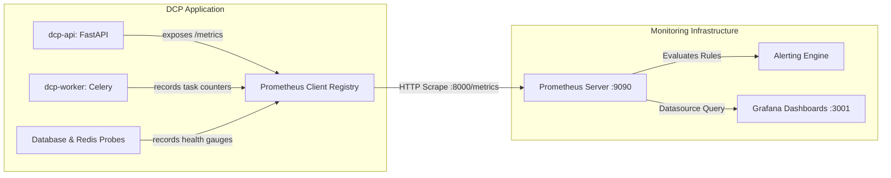

# Observability, Prometheus Metrics & Grafana Dashboards — Developers Code Pulse (DCP)

## 1. Overview & Telemetry Architecture

Developers Code Pulse (DCP) implements a production-grade observability stack based on **Prometheus** (metrics ingestion and alerting) and **Grafana** (real-time visualization).

The platform exposes an authenticated, sanitized `/metrics` endpoint compatible with standard OpenMetrics and Prometheus scrapers.

---

## 2. Prometheus Metric Registry (`backend/app/core/metrics.py`)

| Metric Name | Type | Labels | Description |
| :--- | :--- | :--- | :--- |
| `dcp_http_requests_total` | Counter | `method`, `endpoint`, `status_code` | Cumulative count of HTTP requests processed by the API |
| `dcp_http_request_duration_seconds` | Histogram | `method`, `endpoint` | Request latency distribution in seconds across 11 quantile buckets |
| `dcp_db_connection_status` | Gauge | — | Active PostgreSQL connection status ($1 = \text{healthy}, 0 = \text{failed}$) |
| `dcp_redis_connection_status` | Gauge | — | Active Redis connection status ($1 = \text{healthy}, 0 = \text{failed}$) |
| `dcp_celery_tasks_total` | Counter | `task_name`, `status` | Celery background task executions categorized by task and status |
| `dcp_celery_task_duration_seconds` | Histogram | `task_name` | Celery task execution duration in seconds |
| `dcp_report_generation_duration_seconds` | Histogram | `report_type` | Duration of PDF compilation and AI executive summary synthesis |
| `dcp_webhook_ingestions_total` | Counter | `event_type`, `status` | Total GitHub webhook payloads received and normalized |
| `dcp_bottlenecks_detected_total` | Counter | `severity`, `bottleneck_type` | Workflow bottlenecks identified by the detection engine |

---

## 3. Prometheus Alerting Rules (`infrastructure/monitoring/prometheus/alert_rules.yml`)

The Prometheus instance evaluates the following production alerts:

| Alert Name | Severity | Condition | Threshold & Window | Action / Impact |
| :--- | :--- | :--- | :--- | :--- |
| `ApiDowntime` | Critical | `up{job="dcp-api"} == 0` | 1 minute | API worker unreachable; triggers immediate paging |
| `ElevatedErrorRate` | High | $5\text{xx Ratio} > 5\%$ | 3 minutes | Investigates database errors or unhandled exceptions |
| `HighRequestLatency` | Warning | $\text{p95} > 1.5\text{s}$ | 5 minutes | Investigates slow analytics queries or memory thrashing |
| `DatabaseUnavailability` | Critical | `dcp_db_connection_status == 0` | 1 minute | Database down; triggers database pool reconnect |
| `RedisUnavailability` | Critical | `dcp_redis_connection_status == 0` | 1 minute | Broker offline; worker task execution suspended |
| `RepeatedTaskFailures` | High | $\text{Failures} > 5\%$ | 5 minutes | Checks webhook normalization or GitHub API rate limits |
| `SlowReportGeneration` | Warning | $\text{p90} > 45\text{s}$ | 5 minutes | Investigates ReportLab CPU usage or AI model latency |

---

## 4. Grafana Dashboards

Grafana is pre-provisioned via configuration files (`infrastructure/monitoring/grafana/provisioning/`):
- **Dashboard Title**: `DCP Production Engineering Overview` (`dcp-prod-overview`)
- **Key Panels**:
  1. **HTTP Request Throughput**: Real-time stacked time-series of requests per second segmented by status code (2xx, 3xx, 4xx, 5xx).
  2. **Latency Quantiles**: Live tracking of p50 median, p95 high, and p99 tail latencies.
  3. **Database & Redis Connectivity**: Color-coded stat indicators showing real-time connectivity status.
  4. **Celery Task Throughput**: Task execution volume by task name and completion status (`SUCCESS` vs `FAILURE`).

### Accessing Grafana
- URL: `http://localhost:3001` (or your configured monitoring subdomain)
- Default Username: `admin` (or `${GRAFANA_ADMIN_USER}`)
- Default Password: Configured in `.env` via `${GRAFANA_ADMIN_PASSWORD}`
