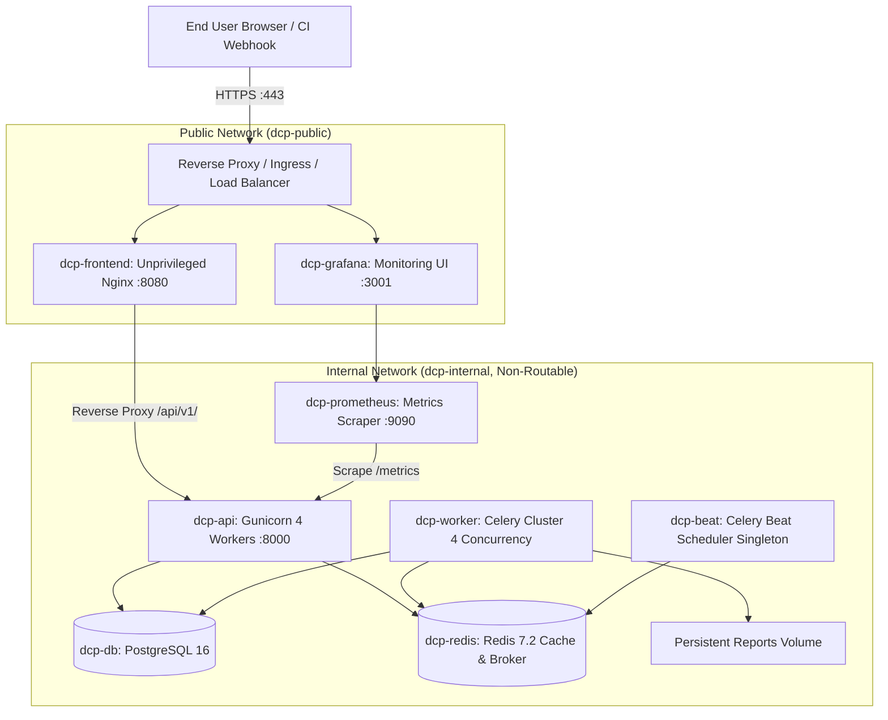

# Production Deployment Architecture & Guide — Developers Code Pulse (DCP)

## 1. Overview & Architecture

Developers Code Pulse (DCP) is designed as a high-availability, containerized, micro-service platform. This guide specifies the production topology, network segmentation, container orchestration via Docker Compose, and infrastructure prerequisites.



---

## 2. Infrastructure Prerequisites

| Component | Minimum Specification | Recommended Production Spec |
| :--- | :--- | :--- |
| **Compute / Host** | 4 vCPU, 8 GB RAM, 50 GB SSD | 8 vCPU, 16 GB RAM, 150 GB NVMe SSD |
| **Operating System** | Linux (Ubuntu 22.04 LTS or Debian 12) | Linux (Ubuntu 22.04 / 24.04 LTS) |
| **Container Engine** | Docker Engine 24.0+, Docker Compose v2.20+ | Docker Engine 26.0+, Docker Compose v2.26+ |
| **Network & Firewall** | Ports 80, 443 open; Ports 5432, 6379, 9090 closed | Ports 80, 443 open with WAF & DDoS mitigation |
| **Domain & TLS** | Valid DNS A record pointing to host | TLS 1.3 certificate issued via Let's Encrypt / ACME |

---

## 3. Production Deployment Step-by-Step

### Step 1: Clone Repository & Create Production Configuration
```bash
git clone https://github.com/Dashwanth15/developers-code-pulse.git /opt/dcp
cd /opt/dcp
git checkout main

# Copy template and generate cryptographically secure secrets
cp .env.example .env
chmod 600 .env
```

Generate secure secrets for `.env`:
```bash
# Generate SECRET_KEY
openssl rand -hex 32

# Generate POSTGRES_PASSWORD
openssl rand -hex 24

# Generate REDIS_PASSWORD
openssl rand -hex 24

# Generate GRAFANA_ADMIN_PASSWORD
openssl rand -hex 16
```
Configure `ENVIRONMENT=production`, `DEBUG=false`, and `CORS_ORIGINS=["https://dcp.yourdomain.com"]`.

### Step 2: Validate Configuration Syntax
```bash
docker compose -f docker-compose.prod.yml config --quiet
```

### Step 3: Launch Supporting Infrastructure
```bash
# Start PostgreSQL and Redis first
docker compose -f docker-compose.prod.yml up -d dcp-db dcp-redis

# Await database and cache healthchecks
docker compose -f docker-compose.prod.yml ps
```

### Step 4: Run Database Migrations
Migrations are run explicitly prior to application startup to avoid racing worker conditions:
```bash
docker compose -f docker-compose.prod.yml run --rm dcp-api alembic upgrade head
```

### Step 5: Start Full Application Cluster
```bash
docker compose -f docker-compose.prod.yml up -d
```

### Step 6: Verify Service Liveness & Readiness
```bash
# 1. API Liveness
curl -f http://localhost/api/v1/health

# 2. API Readiness (PostgreSQL + Redis Connectivity)
curl -f http://localhost/api/v1/ready

# 3. Prometheus Metrics Endpoint
curl -f http://localhost/metrics
```

---

## 4. Zero-Downtime Rolling Update & Rollback

### Rolling Update
```bash
# 1. Pull latest images from container registry
docker compose -f docker-compose.prod.yml pull

# 2. Run schema migrations
docker compose -f docker-compose.prod.yml run --rm dcp-api alembic upgrade head

# 3. Recreate services sequentially
docker compose -f docker-compose.prod.yml up -d --no-deps dcp-api
docker compose -f docker-compose.prod.yml up -d --no-deps dcp-worker dcp-beat
docker compose -f docker-compose.prod.yml up -d --no-deps dcp-frontend
```

### Emergency Rollback Procedure
If a deployment fails health checks:
```bash
# 1. Revert to previous image tag
export PREVIOUS_COMMIT_SHA=293d9d3
docker compose -f docker-compose.prod.yml up -d

# 2. If migration rollback is required:
docker compose -f docker-compose.prod.yml run --rm dcp-api alembic downgrade -1

# 3. Verify health recovery
curl -f http://localhost/api/v1/ready
```

---

## 5. Network Isolation & Security Guarantees

1. **Non-Public Backing Services**: PostgreSQL (`dcp-db`) and Redis (`dcp-redis`) connect exclusively to `dcp-internal`. They have **no host port mappings** and cannot be reached from outside the Docker host.
2. **Unprivileged Containers**:
   - Backend runs as `dcpuser` (UID: 10001).
   - Frontend runs under `nginxinc/nginx-unprivileged` (UID: 101).
3. **Resource Guardrails**: Strict CPU quotas and memory caps are enforced on all containers to prevent noisy-neighbor exhaustion.
