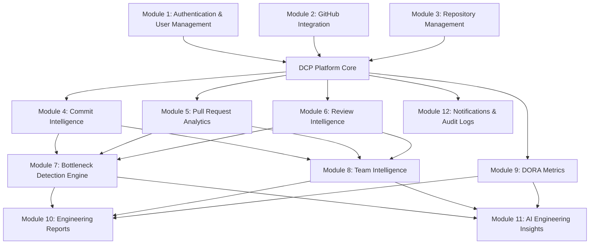

# DEVELOPERS CODE PULSE (DCP)
## Master Project Overview & Product Charter

> **Official Tagline:** *"Understand your team's workflow. Build better software. Ship faster together."*  
> **Repository Name:** `developers-code-pulse`  
> **Backend Service:** `dcp-api`  
> **Database:** `dcp_db`  
> **Docker Compose Project:** `developers-code-pulse`  
> **Product Category:** Developer Productivity and Team Engineering Intelligence Platform

---

## 1. Executive Summary & Vision

**Developers Code Pulse (DCP)** is an enterprise-grade, standalone Developer Productivity and Team Engineering Intelligence platform designed for engineering leaders, managers, and development teams. In modern software engineering organizations, bottlenecks in code reviews, unclear handoffs, uneven workloads, and release friction degrade velocity, team morale, and developer experience. 

DCP integrates directly into the GitHub ecosystem to ingest, normalize, and analyze real-time development activity. It transforms raw Git events into actionable engineering workflow intelligence—without ever devolving into employee surveillance or simplistic individual ranking.

### Core Value Propositions
1. **Holistic Workflow Visibility:** Observe the true end-to-end lifecycle of code from initial branch commit to staging and production deployment.
2. **Review Turnaround Acceleration:** Identify review delays, approval deadlocks, and reviewer burnout through objective, transparent review analytics.
3. **Deterministic Bottleneck Detection:** Detect friction points (e.g., stale pull requests, review queue saturation, deployment drop-offs) via a configurable rules engine backed by metric evidence.
4. **Actionable Delivery Insights (DORA):** Accurately measure Deployment Frequency, Lead Time for Changes, Change Failure Rate, and Mean Time to Restore (MTTR) with honest data availability boundaries.
5. **Contextual AI Recommendations:** Deliver weekly workflow summaries and pragmatic engineering advice strictly grounded in stored analytics data.

---

## 2. Anti-Surveillance Manifesto & Product Philosophy

A fundamental tenet of Developers Code Pulse is **team-level workflow optimization over individual developer surveillance**.

```
+-------------------------------------------------------------+
|             DCP CORE PHILOSOPHY BOUNDARIES                 |
+-------------------------------------------------------------+
| [YES] Team cycle time trends        | [NO] Developer ranking|
| [YES] Review latency & queues       | [NO] Raw LOC counting |
| [YES] Collaboration patterns        | [NO] Keystroke logging|
| [YES] Workload balance & burnout    | [NO] Blame assignment |
| [YES] Delivery pipeline health      | [NO] Secret monitoring|
+-------------------------------------------------------------+
```

### Ethical Engineering Commitments
- **No Individual Scorecards or Stack-Ranking:** DCP does not assign "productivity grades" to individual developers. Raw commit counts, lines of code (LOC), and raw review counts are explicitly contextualized or aggregated at the team and repository level.
- **Systemic Root Cause Identification:** Bottlenecks are treated as workflow design challenges (e.g., architectural complexity, oversized PRs, unclear ownership, tooling delays), not personal failings.
- **Transparent and Configurable Rules:** Every alert, recommendation, and bottleneck insight clearly cites the underlying formula, metric evidence, and measurement timeframe.
- **Privacy & Role-Based Access Control:** Role-based permissions ensure engineering teams own their retrospectives while executive leadership receives aggregate organizational health trends.

---

## 3. Product Questions Answered

DCP empowers software engineering teams to answer critical operational questions:

| Category | Key Questions Answered |
| :--- | :--- |
| **Activity & Cadence** | How active is our development workflow across repositories? Are contribution patterns steady, spiking, or stalling? |
| **Pull Request Flow** | How many PRs are created versus merged? What is our average merge duration? Are oversized PRs slowing down releases? |
| **Review Efficiency** | How long does a PR wait for its first review? What is the approval turnaround time? Which repositories face review backlogs? |
| **Workload Balance** | Is review workload distributed equitably across senior and junior engineers, or are single maintainers creating review bottlenecks? |
| **Bottlenecks** | Where are code reviews stalling? Which PRs have had more than 3 revision rounds? Which queues have exceeded healthy thresholds? |
| **Delivery Performance** | What is our true Lead Time for Changes? How frequently are we shipping to production? What is our Change Failure Rate? |
| **Continuous Improvement**| Is team delivery velocity improving sprint over sprint? What workflow adjustments will unblock our engineers this week? |

---

## 4. Product Modules Architecture Overview

Developers Code Pulse is architected into 12 core, cohesive modules:



### Module Breakdown
- **Module 1: Authentication & User Management:** Multi-tenant organization support, secure Argon2id password hashing, JWT session lifecycle, and Role-Based Access Control (Owner, Admin, Member, Viewer).
- **Module 2: GitHub Integration:** Secure GitHub App integration, webhook ingestion, HMAC-SHA256 signature verification, idempotent delivery deduplication, and GitHub API token management.
- **Module 3: Repository Management:** Organization-level repository discovery, monitoring toggles, synchronization health checkpoints, and metadata tracking.
- **Module 4: Commit Intelligence:** Commit cadence analysis, contribution trendlines, active developer participation, and repository activity heatmaps.
- **Module 5: Pull Request Analytics:** End-to-end PR lifecycle analysis, cycle time calculations, merge time tracking, stale PR identification, and size/churn correlation.
- **Module 6: Review Intelligence:** Signature feature tracking Time to First Review (TTFR), approval latency, review iteration cycles, reviewer workload distribution, and pending review queue health.
- **Module 7: Bottleneck Detection Engine:** Deterministic rule-based evaluation engine flagging delays, queue saturation, and review imbalance with actionable remedies.
- **Module 8: Team Intelligence:** Cross-repository team collaboration trends, review network distribution, and team throughput metrics.
- **Module 9: DORA Metrics:** Deployment Frequency, Lead Time for Changes, Change Failure Rate, and Mean Time to Restore (MTTR) with strict data integrity safeguards.
- **Module 10: Engineering Reports:** Scheduled and on-demand report generation (PDF, CSV, JSON) for weekly retrospectives and executive reviews.
- **Module 11: AI Engineering Insights:** Optional, grounded natural language summarization and recommendations powered by stored analytics snapshots (never hallucinating metrics).
- **Module 12: Notifications & Audit Logs:** In-app and webhook alerts for critical bottlenecks, system events, and comprehensive compliance audit trails.

---

## 5. Target Personas & User Journeys

```
+-----------------------------------------------------------------------------------+
| PERSONA             | PRIMARY GOALS                     | KEY DCP INTERFACES      |
+---------------------+-----------------------------------+-------------------------+
| Engineering Leader  | - Understand team health & DORA   | - DORA Dashboard        |
| (VP Eng / CTO)      | - Optimize cross-team delivery    | - Org Bottleneck Radar  |
|                     | - Strategic resource allocation   | - Executive Reports     |
+---------------------+-----------------------------------+-------------------------+
| Engineering Manager | - Unblock team daily workflow     | - Review Intelligence   |
| (EM)                | - Prevent reviewer burnout        | - PR Aging Dashboard    |
|                     | - Run data-backed retrospectives  | - Weekly Insights       |
+---------------------+-----------------------------------+-------------------------+
| Tech Lead / Staff   | - Accelerate PR turnaround        | - Review Queue Health   |
| Engineer            | - Maintain code review standards  | - Repositories View     |
|                     | - Spot architectural friction     | - Bottleneck Alerts     |
+---------------------+-----------------------------------+-------------------------+
| Software Engineer   | - Get timely reviews on PRs       | - Personal Review Queue |
| (Developer)         | - Avoid context switching         | - PR Status & Timeline  |
|                     | - Balanced code review duty       | - Team Cadence          |
+---------------------+-----------------------------------+-------------------------+
```

---

## 6. Success Criteria & KPIs

The platform’s success in production will be evaluated against:
1. **System Reliability & Processing:**
   - 99.9% uptime for the API and dashboard.
   - Sub-500ms webhook receipt and Redis queue acknowledgment.
   - 100% idempotent handling of duplicate GitHub webhook deliveries.
2. **Measurement Accuracy:**
   - Zero hallucinated or fabricated metrics.
   - Clear distinction between actual values, estimates, and "Insufficient Data" states.
3. **Engineering Team Impact:**
   - Measurable reduction in Pull Request Time to First Review (TTFR).
   - Reduction in stale (>7 days) unmerged Pull Requests.
   - More balanced code review distribution across team members.
