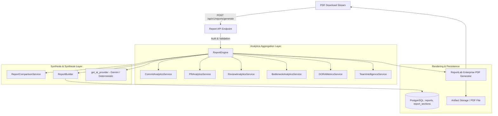

# Reporting Engine Architecture — Developers Code Pulse (DCP)

## 1. Overview & Objective

The **Developers Code Pulse (DCP) Reporting Engine** is an enterprise-grade reporting and executive intelligence system that transforms engineering telemetry into structured, evidence-backed reports and executive documents.

Rather than generating raw metrics in isolation, the reporting engine harmonizes signals across:
- **Phase 3 (Commit Intelligence)**: Churn, commit cadence, active contributors.
- **Phase 4 (Pull Request Intelligence)**: PR cycle times, merge latency, size distribution, merge rate.
- **Phase 5 (Review Intelligence)**: Time-to-first-review (TTFR), approval turnaround, reviewer balance (Gini index).
- **Phase 6 (Bottleneck Detection Engine)**: Active workflow friction, review queues, stall states.
- **Phase 7 (Team Intelligence & DORA Metrics)**: 4 DORA pillars, macro throughput, cross-repo delivery flow.
- **Phase 8 (AI Engineering Insights)**: Grounded, evidence-backed explanations and systemic recommendations.

---

## 2. Core Architectural Principles

1. **Strict Metric Grounding**: Metrics are calculated solely by deterministic analytics engines. The reporting engine and AI layer never fabricate, hallucinate, or extrapolate metrics.
2. **Multi-Tenant Isolation**: Every report query, section, and scheduled task is bounded by the authenticated `organization_id`. Cross-tenant queries are prevented at the database and application levels.
3. **Period-over-Period Delta Analysis**: Reports compare the active reporting period against an identical preceding baseline period to highlight positive and deteriorating trends.
4. **Asynchronous PDF Rendering**: High-fidelity, multi-page PDFs are rendered using ReportLab asynchronously, supporting on-demand downloads and automated delivery without blocking web worker threads.
5. **Anti-Surveillance & Privacy Charter Compliance**: Reports measure pipeline flow, review efficiency, and deployment cadence. Individual developer rankings, personal velocity scoring, and surveillance KPIs are strictly prohibited.

---

## 3. Supported Report Types

DCP provides 5 specialized report types tailored to specific engineering audiences:

| Report Type | Target Audience | Primary Focus | Key Metrics Included |
| :--- | :--- | :--- | :--- |
| `ENGINEERING_HEALTH` | VP of Eng, CTO, Heads of Engineering | Full-spectrum organizational delivery health | PR throughput, cycle times, TTFR, reviewer balance, active bottlenecks, 4 DORA pillars, systemic recommendations |
| `WEEKLY` | Engineering Managers, Tech Leads | Sprint cadence & operational retrospectives | PRs opened/merged, merge rate, median cycle time, median TTFR, active bottlenecks, weekly deployments, period deltas |
| `MONTHLY` | Engineering Leadership, Executive Team | Long-term delivery trends & strategic improvements | Monthly development volume, delivery trends, resolved vs active bottlenecks, DORA performance shifts, strategic recommendations |
| `REPOSITORY_HEALTH` | Repository Owners, Tech Leads | Single-codebase workflow diagnostics | Repository commit cadence, PR throughput, review latency, repository-specific bottlenecks, deployment history |
| `DORA` | DevOps, Platform Engineers, SREs | Delivery velocity and operational stability | Deployment Frequency, Lead Time for Changes, Change Failure Rate, Time to Restore Service, performance benchmarks, provenance |

---

## 4. System Architecture & Component Interaction

---

## 5. Modular Service Responsibilities

### `ReportEngine` (`backend/app/services/reports/report_engine.py`)
- Central coordinator for report generation requests.
- Resolves date windows (presets like `7d`, `14d`, `30d`, `90d` or custom ISO ranges).
- Queries domain analytics services concurrently.
- Computes period-over-period baseline deltas via `ReportComparisonService`.
- Coordinates AI insight synthesis via configured `BaseAIProvider`.
- Invokes `ReportBuilder` to assemble structured sections.
- Invokes `pdf_generator.py` to compile enterprise PDF binaries.
- Persists report metadata and individual sections within an atomic transaction.

### `ReportBuilder` (`backend/app/services/reports/report_builder.py`)
- Implements report-type-specific layout logic.
- Assembles sections:
  1. `EXECUTIVE_SUMMARY`: High-level narrative and vital takeaways.
  2. `THROUGHPUT_METRICS`: PR and commit cadence tables with period deltas.
  3. `REVIEW_INTELLIGENCE`: Turnaround, coverage, and workload distribution.
  4. `BOTTLENECK_RADAR`: Critical and high severity workflow friction points.
  5. `DORA_PILLARS`: The 4 DORA metrics, benchmark tiers, and missing data warnings.
  6. `RECOMMENDATIONS`: Actionable systemic engineering improvements.
  7. `METHODOLOGY`: Data provenance, limitations, and Anti-Surveillance notices.

### `ReportComparisonService` (`backend/app/services/reports/report_comparison.py`)
- Computes period deltas: $\Delta = V_{\text{current}} - V_{\text{baseline}}$.
- Calculates percentage change and directionality (`IMPROVED`, `DEGRADED`, `STABLE`).
- Inverts polarity for latency metrics where lower values represent improvement (e.g. cycle time, TTFR, MTTR, change failure rate).

### `pdf_generator.py` (`backend/app/services/reports/pdf_generator.py`)
- ReportLab-based document compiler producing PDF artifacts.
- Implements two-pass page numbering (`Page X of Y`).
- Custom enterprise design system: slate primary header, crisp metric cards, formatted comparison tables, and visual benchmark badges.

---

## 6. Database Schema

### `reports` Table
- `id` (UUID, Primary Key)
- `organization_id` (UUID, Foreign Key to organizations, Indexed)
- `repository_id` (UUID, Nullable Foreign Key to repositories, Indexed)
- `report_type` (VARCHAR: `ENGINEERING_HEALTH`, `WEEKLY`, `MONTHLY`, `REPOSITORY_HEALTH`, `DORA`)
- `title` (VARCHAR)
- `reporting_period_start` (TIMESTAMPTZ)
- `reporting_period_end` (TIMESTAMPTZ)
- `status` (VARCHAR: `PENDING`, `GENERATING`, `COMPLETED`, `FAILED`)
- `file_reference` (VARCHAR, Filepath on disk or S3 URI)
- `generated_at` (TIMESTAMPTZ)
- `generated_by` (UUID, Nullable Foreign Key to users)
- `metadata_payload` (JSONB: comparison metrics, options, AI flags)

### `report_sections` Table
- `id` (UUID, Primary Key)
- `report_id` (UUID, Foreign Key to reports, Indexed)
- `section_type` (VARCHAR: `EXECUTIVE_SUMMARY`, `KPI_SUMMARY`, `THROUGHPUT`, `BOTTLENECKS`, `DORA`, etc.)
- `title` (VARCHAR)
- `content` (JSONB: structured figures, tables, text)
- `evidence` (JSONB: raw telemetry metrics for provenance tracing)
- `order_index` (INTEGER, display sort order)

---

## 7. API Specification

| Endpoint | Method | Description |
| :--- | :--- | :--- |
| `/api/v1/reports` | `GET` | List generated reports with pagination, type, and repo filtering |
| `/api/v1/reports/{id}` | `GET` | Retrieve complete report details including all parsed sections |
| `/api/v1/reports/generate` | `POST` | Trigger report generation and PDF rendering |
| `/api/v1/reports/{id}/download` | `GET` | Securely download the generated PDF binary |
| `/api/v1/reports/scheduled` | `GET` | List automated recurring report schedules |
| `/api/v1/reports/scheduled` | `POST` | Create a new recurring report schedule |
| `/api/v1/reports/scheduled/{id}` | `PATCH` | Update schedule configuration or toggle enabled state |
| `/api/v1/reports/scheduled/{id}` | `DELETE` | Delete an automated report schedule |

---

## 8. Verification & Test Coverage

The reporting engine is covered by automated unit and integration tests in `backend/tests/test_reports_and_insights_phase8.py`:
- `test_pdf_generation_creates_valid_pdf_file`: Validates ReportLab PDF creation, magic bytes, and minimal file sizes.
- `test_report_comparison_service_computes_deltas`: Validates percentage change and latency polarity inversion.
- `test_report_builder_sections_assembly`: Validates section completeness for all 5 report types.
- `test_report_engine_generate_report_flow`: Validates full end-to-end execution, database persistence, and file output.
- `test_reports_api_endpoints`: Validates HTTP API contracts, generation payload handling, and PDF download authorization.
