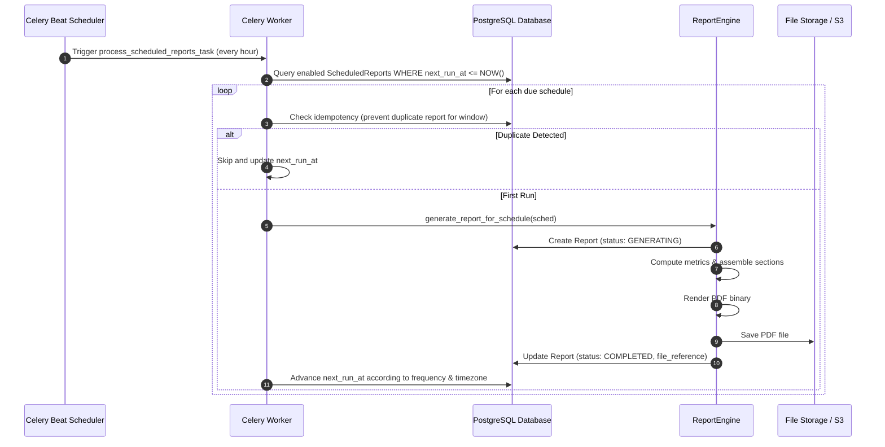

# Scheduled Reports Engine — Developers Code Pulse (DCP)

## 1. Overview & Objectives

The **Scheduled Reports Engine** provides automated, hands-off compilation and distribution of engineering retrospectives and executive reports.

Engineering managers, tech leads, and leadership can configure recurring cadences (Daily, Weekly, Monthly) to receive standardized PDF reports and executive summaries directly in their inboxes or management channels.

---

## 2. Architecture & Execution Flow

---

## 3. Scheduling Frequencies & Next-Run Calculation

| Frequency | Cadence | Default Execution Timing |
| :--- | :--- | :--- |
| `DAILY` | Every 24 hours | 00:00 local time in configured timezone |
| `WEEKLY` | Every 7 days | Monday 00:00 local time in configured timezone |
| `MONTHLY` | Monthly | 1st day of month 00:00 local time in configured timezone |

### Timezone Resolution
- Schedules store a standard IANA timezone identifier (e.g., `UTC`, `America/New_York`, `Europe/London`, `Asia/Kolkata`).
- `next_run_at` is always computed and stored in **UTC** while respecting the target timezone's daylight savings and midnight boundaries.

---

## 4. Idempotency & Deduplication Guarantees

To ensure system stability and prevent duplicate email spam or wasted compute:
1. **Window Deduplication**: Before kicking off report generation, the task checks whether an existing report with matching `organization_id`, `repository_id`, `report_type`, and `reporting_period_end` already exists with status `COMPLETED` or `GENERATING`.
2. **Worker Concurrency Locks**: Distributed lock tokens per schedule prevent multiple Celery worker processes from picking up the same scheduled report trigger simultaneously.
3. **Graceful Error Recovery**: If report generation encounters a transient database or network failure, the schedule state records the failure without corrupting `next_run_at`, scheduling a controlled retry with exponential backoff.

---

## 5. Database Schema (`scheduled_reports` Table)

- `id` (UUID, Primary Key)
- `organization_id` (UUID, Foreign Key to organizations, Indexed)
- `repository_id` (UUID, Nullable Foreign Key to repositories, Indexed)
- `report_type` (VARCHAR: `ENGINEERING_HEALTH`, `WEEKLY`, `MONTHLY`, `REPOSITORY_HEALTH`, `DORA`)
- `frequency` (VARCHAR: `DAILY`, `WEEKLY`, `MONTHLY`)
- `next_run_at` (TIMESTAMPTZ, Indexed)
- `timezone` (VARCHAR, Default `'UTC'`)
- `enabled` (BOOLEAN, Default `true`, Indexed)
- `recipients` (JSONB / ARRAY: list of recipient email strings)
- `created_by` (UUID, Nullable Foreign Key to users)
- `created_at` (TIMESTAMPTZ)
- `updated_at` (TIMESTAMPTZ)

---

## 6. Celery Background Tasks (`backend/app/workers/tasks.py`)

### `process_scheduled_reports_task`
- **Schedule**: Periodic task executed on Celery Beat.
- **Action**: Queries all active schedules whose `next_run_at <= now()`, spawns asynchronous `generate_report_task` workers, and updates `next_run_at`.

### `generate_report_task`
- **Arguments**: `organization_id`, `report_type`, `repository_id`, `time_range`, `include_ai_insights`.
- **Action**: Orchestrates metric aggregation, AI executive synthesis, section compilation, and PDF rendering in the background.

---

## 7. API Specification

| Endpoint | Method | Request Payload | Response |
| :--- | :--- | :--- | :--- |
| `/api/v1/reports/scheduled` | `GET` | — | `ScheduledReportListResponse` |
| `/api/v1/reports/scheduled` | `POST` | `ScheduledReportCreateRequest` | `ScheduledReportResponse` (201 Created) |
| `/api/v1/reports/scheduled/{id}` | `PATCH` | `ScheduledReportUpdateRequest` | `ScheduledReportResponse` (200 OK) |
| `/api/v1/reports/scheduled/{id}` | `DELETE` | — | `204 No Content` |
