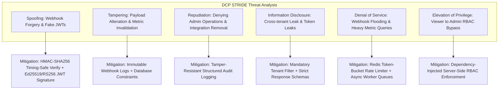

# DEVELOPERS CODE PULSE (DCP)
## Security Model, RBAC, and Threat Architecture

---

## 1. Security Architecture Principles

Developers Code Pulse handles sensitive engineering workflow data, repository metadata, and GitHub App credentials. Security is baked into the foundation through:

1. **Defense in Depth:** Security controls at ingress (Nginx/Cloudflare), routing (FastAPI middlewares), service boundary (tenant context validation), and storage (DB foreign keys and schema isolation).
2. **Principle of Least Privilege:** Minimum required GitHub App permissions, strict role-based access control, and short-lived credential lifespans.
3. **Zero Frontend Secret Exposure:** GitHub App private keys, webhook signing secrets, and database credentials never touch frontend bundles or client-side responses.
4. **Mandatory Tenant Scoping:** Every authenticated request executes within an explicitly resolved `organization_id` context. Cross-organization data access is impossible at both query and database levels.
5. **Anti-Surveillance Privacy Boundaries:** Technical safeguards prevent turning team engineering metrics into punitive individual tracking.

---

## 2. Threat Modeling (STRIDE Methodology)



### STRIDE Assessment & Mitigations Matrix

| Threat Category | Potential Vulnerability | System Mitigation | Verification Test |
| :--- | :--- | :--- | :--- |
| **Spoofing** | Adversary sends fake GitHub webhook requests to inject malicious commit or PR records. | 1. Verification of `X-Hub-Signature-256` using `hmac.compare_digest`.<br/>2. Rejection of all requests failing signature check with 401.<br/>3. Replay protection via `X-GitHub-Delivery` uniqueness. | `test_invalid_webhook_signature_rejected()` |
| **Spoofing** | Forged user authentication tokens. | Signed JWT tokens with short expiry (15 mins), verified with secret server key; refresh tokens stored as salted hashes. | `test_expired_or_forged_jwt_rejected()` |
| **Tampering** | Modification of metric formulas or in-flight API payloads. | Strict Pydantic v2 schema validation; TLS 1.3 in transit; PostgreSQL foreign key and check constraints. | `test_invalid_schema_payload_rejected()` |
| **Repudiation** | User disconnects repository or changes roles and denies doing so. | Append-only `audit_logs` table recording actor ID, IP address, timestamp, action name, and change diff JSONB. | `test_audit_log_recorded_on_admin_action()` |
| **Information Disclosure** | User from Org A queries repositories or metrics belonging to Org B. | Multi-tenant middleware resolves caller's authorized organizations. Queries enforce `WHERE organization_id = :org_id`. | `test_cross_tenant_isolation()` |
| **Information Disclosure** | GitHub App private key or DB passwords exposed in logs. | Structlog filtering sensitive keys (`password`, `token`, `secret`, `authorization`, `private_key`); safe Pydantic serializer models. | `test_log_sanitization_masks_credentials()` |
| **Denial of Service** | Massive webhook flood or repetitive expensive DORA analytics queries. | 1. Webhook endpoint returns 202 in <50ms, delegating work to Redis queue.<br/>2. Redis sliding-window rate limiting per IP and per org.<br/>3. Pre-aggregated `metric_snapshots` prevent expensive live joins. | `test_rate_limiter_throttles_excessive_traffic()` |
| **Elevation of Privilege**| Viewer user triggers repository synchronization or deletes integration. | Server-side RBAC dependencies (`require_role(Role.ADMIN)`); frontend role checks are purely decorative. | `test_viewer_cannot_trigger_sync()` |

---

## 3. Role-Based Access Control (RBAC) Matrix

DCP defines four discrete organizational roles:

| Action / Capability | Viewer | Member | Administrator | Organization Owner |
| :--- | :---: | :---: | :---: | :---: |
| View Dashboards & Pull Request Analytics | :white_check_mark: | :white_check_mark: | :white_check_mark: | :white_check_mark: |
| View Review Intelligence & Bottlenecks | :white_check_mark: | :white_check_mark: | :white_check_mark: | :white_check_mark: |
| View DORA Delivery Metrics | :white_check_mark: | :white_check_mark: | :white_check_mark: | :white_check_mark: |
| Export Reports (PDF, CSV, JSON) | :white_check_mark: | :white_check_mark: | :white_check_mark: | :white_check_mark: |
| Trigger On-Demand AI Insights | :x: | :white_check_mark: | :white_check_mark: | :white_check_mark: |
| Connect / Disconnect Repositories | :x: | :x: | :white_check_mark: | :white_check_mark: |
| Trigger Manual Repository Backfill / Sync | :x: | :x: | :white_check_mark: | :white_check_mark: |
| Configure Bottleneck Detection Thresholds | :x: | :x: | :white_check_mark: | :white_check_mark: |
| Invite New Team Members | :x: | :x: | :white_check_mark: | :white_check_mark: |
| Install / Uninstall GitHub App | :x: | :x: | :x: | :white_check_mark: |
| Modify Organization Settings & Billing | :x: | :x: | :x: | :white_check_mark: |
| Promote / Demote Members or Admins | :x: | :x: | :x: | :white_check_mark: |
| Delete Organization | :x: | :x: | :x: | :white_check_mark: |

---

## 4. Credential Management & Token Lifecycles

```
+----------------------------------------------------------------------------------+
| CREDENTIAL                 | STORAGE LOCATION            | LIFESPAN / EXPIRATION |
+----------------------------+-----------------------------+-----------------------+
| User Password              | DB (Argon2id Hash)          | Permanent until reset |
| User Access Token (JWT)    | HTTP Authorization Header   | 15 minutes            |
| User Refresh Token         | DB (SHA-256 Hash)           | 7 days (Rotated)      |
| GitHub App RSA Private Key | Secure Env Var / Vault      | Annual Rotation       |
| GitHub App JWT             | In-Memory Only              | 10 minutes            |
| GitHub Installation Token  | Redis Cache (dcp-redis)     | 50 minutes (TTL)      |
| Webhook Secret             | Secure Env Var              | Managed Secret        |
| AI Provider API Key        | Secure Env Var (Backend)    | Managed Secret        |
+----------------------------------------------------------------------------------+
```

---

## 5. Developer Privacy & Anti-Surveillance Safeguards

To maintain psychological safety and trust within engineering teams:
1. **Aggregated Review Workload:** Review distribution is displayed to reveal systemic imbalance and bottlenecks (e.g., senior engineers overwhelmed by review requests), not to shame low-volume reviewers.
2. **Exclusion of Code Volume as a KPI:** Lines of code (LOC) and raw commit tallies are strictly marked as **contextual sizing indicators**, explicitly decoupled from developer competency evaluation.
3. **No Keylogging or PII Ingestion:** DCP neither inspects nor stores source code files, proprietary intellectual property, employee keystrokes, or commit diff contents beyond standard line-change summaries.
4. **Transparent Algorithm Logic:** The exact formulas and data triggers behind any detected bottleneck are fully visible to team members, ensuring zero opaque "AI scoring".
