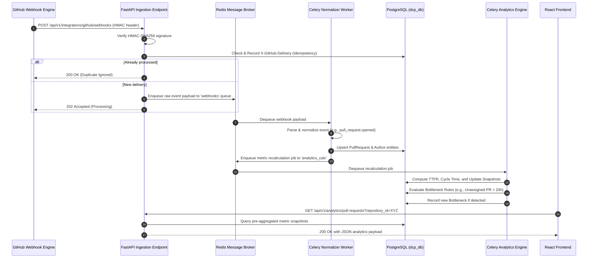

# DEVELOPERS CODE PULSE (DCP)
## System Architecture Specification

---

## 1. Architectural Philosophy & Strategy

Developers Code Pulse (DCP) follows a **Modular Monolith** architecture backed by asynchronous distributed worker queues. 

### Why a Modular Monolith?
1. **Bounded Domain Complexity:** DCP is a focused SaaS platform with strongly interconnected domain models (repositories, PRs, reviews, metrics, users). Splitting these into independent microservices prematurely introduces distributed transaction overhead, network latency, distributed data consistency issues, and operational complexity.
2. **Clear Boundaries via Python Modules:** Each core domain (e.g., `services/auth`, `services/github`, `services/analytics`, `services/bottlenecks`) maintains strict internal isolation. Shared access is mediated via typed schemas, database transactions, and service layer methods.
3. **Independent Scalability of Compute-Intensive Tasks:** Webhook processing, historical backfill, analytics calculations, and report rendering are decoupled from the user-facing HTTP request path via Redis and Celery workers. The HTTP API remains ultra-responsive under high webhook volume.
4. **Unified Deployment and Observability:** Single container image for the backend API and worker processes simplifies CI/CD, local development, and monitoring.

---

## 2. High-Level System Architecture Diagram

```mermaid
graph TB
    subgraph External_GitHub_Ecosystem["External GitHub Ecosystem"]
        GH_Repos["GitHub Repositories"]
        GH_App["GitHub App Installation"]
        GH_Hooks["GitHub Webhooks (HMAC-SHA256)"]
        GH_API["GitHub REST / GraphQL API"]
        GH_Actions["GitHub Actions Workflows"]
    end

    subgraph Ingress_Security["Edge & Reverse Proxy"]
        Nginx["Nginx Reverse Proxy / SSL Termination"]
    end

    subgraph User_Interface["Presentation Layer (Frontend)"]
        SPA["React 18 + Vite Single Page Application<br/>(TypeScript, Tailwind CSS, shadcn/ui, Recharts)"]
    end

    subgraph Application_Core["Backend Core: dcp-api (FastAPI)"]
        API_Gateway["FastAPI Router (/api/v1)"]
        Auth_Middleware["Auth & RBAC Middleware (JWT / Tenant Isolation)"]
        Webhook_Endpoint["Webhook Ingestion Endpoint (/integrations/github/webhooks)"]
        Sync_Endpoint["Sync & Admin Endpoint (/repositories/{id}/sync)"]
        Query_APIs["Analytics & Reporting Query Endpoints"]
    end

    subgraph Async_Queue["Distributed Task & Event Queue"]
        Redis_Broker[("Redis 7.2 Broker & Result Backend")]
        Queue_Webhooks["Queue: webhooks (high priority)"]
        Queue_Sync["Queue: repo_sync (normal priority)"]
        Queue_Analytics["Queue: analytics_calc (scheduled/low)"]
        Queue_Reports["Queue: report_gen (batch)"]
    end

    subgraph Celery_Worker_Pool["Celery Distributed Workers (Python 3.12)"]
        Worker_Normalizer["Event Normalizer & Ingestion Worker"]
        Worker_Sync["GitHub Backfill & Reconciliation Worker"]
        Worker_Analytics["Analytics Calculation & Aggregation Engine"]
        Worker_Bottlenecks["Deterministic Bottleneck Detection Worker"]
        Worker_Reports["Report Generator (PDF/CSV/JSON) & AI Summaries"]
        Celery_Beat["Celery Beat Scheduler (Cron & Heartbeats)"]
    end

    subgraph Persistence_Layer["Data Persistence & Caching"]
        Postgres[("PostgreSQL 16 (dcp_db)<br/>UUIDs, Foreign Keys, Indexes, JSONB Metadata")]
        Redis_Cache[("Redis 7.2 Cache<br/>Rate limits, Tokens, Snapshot Cache")]
    end

    subgraph Observability_Monitoring["Observability & Monitoring"]
        Prometheus["Prometheus Metrics Collector (/metrics)"]
        Grafana["Grafana Dashboards"]
        App_Logs["Structured JSON Logging (stdout)"]
    end

    %% Connections
    GH_Repos --> GH_App
    GH_App --> GH_Hooks
    GH_Hooks --> Nginx
    GH_Actions --> Nginx
    SPA <--> Nginx

    Nginx --> SPA
    Nginx --> API_Gateway

    API_Gateway --> Auth_Middleware
    Auth_Middleware --> Query_APIs
    Auth_Middleware --> Sync_Endpoint
    Nginx --> Webhook_Endpoint

    Webhook_Endpoint -->|1. Validate HMAC & Save Delivery Record| Postgres
    Webhook_Endpoint -->|2. Push raw event to queue| Queue_Webhooks
    Sync_Endpoint -->|Enqueue reconciliation| Queue_Sync

    Queue_Webhooks --> Redis_Broker
    Queue_Sync --> Redis_Broker
    Queue_Analytics --> Redis_Broker
    Queue_Reports --> Redis_Broker

    Redis_Broker --> Worker_Normalizer
    Redis_Broker --> Worker_Sync
    Redis_Broker --> Worker_Analytics
    Redis_Broker --> Worker_Bottlenecks
    Redis_Broker --> Worker_Reports
    Celery_Beat --> Redis_Broker

    Worker_Normalizer -->|Upsert normalized entities| Postgres
    Worker_Normalizer -->|Trigger metric rollup| Queue_Analytics
    Worker_Sync -->|Fetch PRs/Commits/Reviews| GH_API
    Worker_Sync -->|Upsert entities| Postgres
    Worker_Analytics -->|Read event entities| Postgres
    Worker_Analytics -->|Write metric_snapshots| Postgres
    Worker_Analytics -->|Trigger bottleneck check| Queue_Analytics
    Worker_Bottlenecks -->|Evaluate rules & save bottlenecks| Postgres
    Worker_Reports -->|Read snapshots & generate file| Postgres

    Query_APIs -->|Read metrics & entities| Postgres
    Query_APIs -->|Read cached stats| Redis_Cache

    API_Gateway --> Prometheus
    Worker_Normalizer --> Prometheus
    Prometheus --> Grafana
    API_Gateway --> App_Logs
    Worker_Normalizer --> App_Logs
```

---

## 3. Subsystem Breakdown & Component Responsibilities

### 3.1 Frontend Single Page Application (SPA)
- **Tech Stack:** React 18, TypeScript, Vite, Tailwind CSS, shadcn/ui, Recharts, TanStack Query (React Query v5), React Router v6, Lucide Icons, Zod.
- **Key Responsibilities:**
  - Fast, client-side routed, responsive SaaS interface.
  - Organization and repository context selection via global React Context.
  - Data querying with client-side caching, background refetching, and optimistic updates via TanStack Query.
  - Interactive charts (area charts, stacked bar charts, scatter plots for review times, workload heatmaps) via Recharts.
  - Clear empty, loading, error, and "insufficient data" state displays.
  - Theme switching (system, light, and sleek dark mode).

### 3.2 FastAPI Application Gateway (`dcp-api`)
- **Tech Stack:** Python 3.12, FastAPI, Pydantic v2, SQLAlchemy 2.0 (asyncio + asyncpg), Structlog.
- **Key Responsibilities:**
  - High-performance asynchronous HTTP handling.
  - Global middleware: Request ID tracing (`X-Request-ID`), structured access logs, CORS validation, rate limiting, exception handling.
  - Authentication and RBAC enforcement: Validating Bearer JWTs and resolving tenant organization permissions on every protected endpoint.
  - Webhook Ingress: Receiving GitHub webhook payloads, timing-safe HMAC-SHA256 signature verification, recording delivery identifier for idempotency, and immediate 202 Accepted return within <50ms.
  - Query APIs: Serving paginated, filtered analytics data directly from PostgreSQL with Redis-backed read caching for expensive dashboard queries.

### 3.3 Asynchronous Task Queue & Scheduling (Celery + Redis)
- **Tech Stack:** Celery 5.4, Redis 7.2.
- **Queue Topology:**
  - `webhooks`: High-priority queue dedicated to raw event parsing and normalization.
  - `repo_sync`: Normal-priority queue for initial repository backfills and scheduled syncs.
  - `analytics_calc`: Event-driven and periodic metric recalculations and bottleneck evaluations.
  - `report_gen`: Low-priority/batch queue for compiling heavy CSV/PDF reports and AI insights.
- **Celery Beat:**
  - Hourly reconciliation checks for active repositories.
  - Daily snapshot rollups.
  - Weekly report generation triggers.

### 3.4 Domain Services Layer
Located under `backend/app/services/`:
1. **`auth/`:** User registration, password verification with Argon2id, JWT token issuance, refresh token rotation, organization membership management.
2. **`github/`:** GitHub App JWT authentication, installation access token lifecycle management, GitHub REST & GraphQL clients with rate-limit and backoff handlers.
3. **`commits/`:** Commit ingestion, author resolution, contribution cadence aggregation.
4. **`pull_requests/`:** PR state machine tracking (open, closed, merged, draft), cycle time calculations, stale PR monitoring.
5. **`reviews/`:** PR review ingestion, Time to First Review (TTFR) calculation, approval turnaround tracking, reviewer workload indexing.
6. **`analytics/`:** Core analytical algorithms, sliding-window calculations (7d, 14d, 30d, 90d), percentile distributions (P50, P75, P90).
7. **`bottlenecks/`:** Deterministic rules engine evaluating repository thresholds to flag bottlenecks with actionable recommendations.
8. **`dora/`:** Deployment Frequency, Lead Time for Changes, Change Failure Rate, and MTTR engine with explicit data source verification.
9. **`reports/`:** PDF/CSV/JSON report generation pipeline and optional AI-assisted narrative synthesis.
10. **`notifications/`:** In-app notification triggers and external audit log recording.

### 3.5 Persistence Layer
- **PostgreSQL 16:**
  - Primary relational store with ACID guarantees.
  - Strict tenant isolation using `organization_id` foreign keys.
  - Specialized indexes (B-tree, compound indexes, partial indexes for open PRs).
  - JSONB used strictly for storing raw webhook payloads and configurable rule criteria.
- **Redis 7.2:**
  - Message broker for Celery queues.
  - Ephemeral cache for GitHub App installation access tokens (with TTL matching GitHub's 1-hour expiration).
  - Sliding-window API rate limiting storage.
  - Temporary cache for aggregated dashboard summary cards.

---

## 4. End-to-End Data Flow

---

## 5. Architectural Non-Functional Requirements & Design Principles

| Category | Principle / Standard | Implementation in DCP |
| :--- | :--- | :--- |
| **Data Integrity** | Absolute Auditability & Idempotency | Every webhook delivery is recorded with `delivery_id`. Re-delivered events are gracefully skipped without side effects. |
| **Tenant Isolation** | Strict Multi-Tenancy | Every database query scoped to an organization validates caller's `organization_id` via DB constraints and API dependencies. |
| **Performance** | Sub-second Dashboard Loads | Raw events are not aggregated on-the-fly during user dashboard queries; pre-aggregated `metric_snapshots` are read. |
| **Resilience** | Exponential Backoff & Retry | Celery tasks communicating with GitHub API employ jittered exponential backoff honoring GitHub's `Retry-After` header. |
| **Security** | Zero Hardcoded Secrets | All tokens, private keys, and connection strings originate from environment variables or secure key vaults. |
| **Extensibility** | Plugin-Ready Integrations | Modular event normalizer allows expanding from GitHub to GitLab or Bitbucket in the future without changing core analytics models. |
