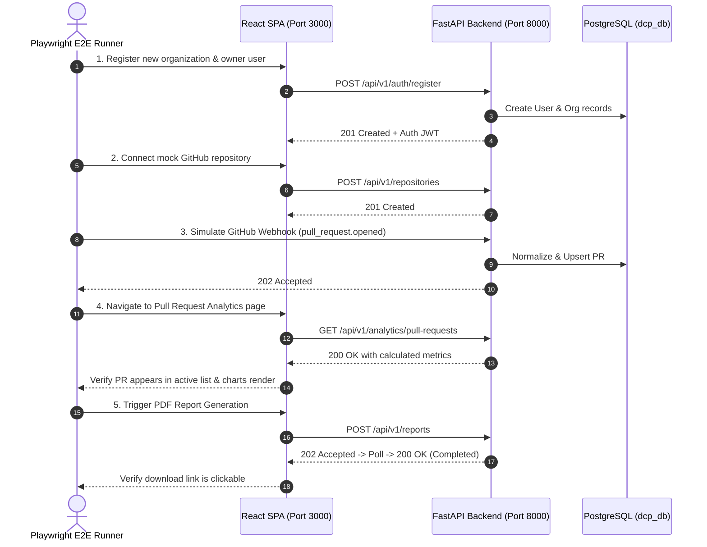

# DEVELOPERS CODE PULSE (DCP)
## Automated Testing & Quality Assurance Strategy

---

## 1. Testing Pyramid & Quality Philosophy

Developers Code Pulse enforces a rigorous, multi-tiered testing strategy to guarantee metric correctness, tenant isolation, and zero-defect deployments.

```
                   /\
                  /  \
                 / E2E\           Playwright (Critical User Journeys)
                /------\
               /  Integ \         Pytest + HTTPX + Test DB (API & Webhooks)
              /----------\
             / Component  \       Vitest + React Testing Library + MSW
            /--------------\
           /   Unit Tests   \     Pytest (Analytics Engine, Math, Normalizer)
          /------------------\
```

### Core Testing Commitments
1. **Zero Faked Production Metrics:** Test fixtures are explicitly marked as synthetic data (`tests/fixtures/`) and never confused with production analytics.
2. **Deterministic Metric Validation:** Mathematical formulas for TTFR, Cycle Time, Merge Rate, and DORA metrics are verified against known edge-case datasets (e.g., weekend delays, draft PR transitions, squash merges).
3. **Strict Coverage Gates:** CI automatically enforces code coverage thresholds:
   - **Core Analytics & Bottleneck Engine:** $\ge 85\%$ line coverage.
   - **Backend API & Services:** $\ge 80\%$ line coverage.
   - **Frontend Components & Utilities:** $\ge 75\%$ line coverage.

---

## 2. Backend Testing Architecture (Pytest & HTTPX)

### 2.1 Test Hierarchy & Tools
- **Runner:** `pytest` with `pytest-asyncio`, `pytest-cov`, `pytest-mock`.
- **HTTP Client:** `httpx.AsyncClient` for testing asynchronous FastAPI endpoints without network overhead.
- **Database Isolation:** PostgreSQL test instance running in Docker or SQLite in-memory (with JSONB emulation), executing Alembic migrations per test session with transaction rollbacks per test method.

### 2.2 Key Backend Test Suites

#### 1. Authentication & Tenant Isolation (`tests/test_auth.py`, `tests/test_tenancy.py`)
- User registration, password verification with Argon2id, JWT token issuance and expiration.
- Assertion that User A in Organization 1 cannot query or modify repositories in Organization 2 (HTTP 404/403).
- Role-based access control tests (e.g., Viewer role attempting to trigger sync receives HTTP 403 Forbidden).

#### 2. Webhook Ingress & Cryptographic Verification (`tests/test_webhooks.py`)
- Validation of valid HMAC-SHA256 signatures returning HTTP 202 Accepted.
- Rejection of tampered payloads or missing headers with HTTP 401 Unauthorized.
- Verification of idempotency: submitting the identical `X-GitHub-Delivery` twice returns HTTP 200 without enqueuing a duplicate task.

#### 3. Analytics Calculation Engine (`tests/test_analytics.py`)
- **PR Lifecycle Calculations:**
  - Verify $T_{\text{merge}}$ correctly subtracts draft duration.
  - Verify $T_{\text{review}}$ captures the first non-author, non-bot review.
  - Verify cycle time handles squash merges by referencing the initial author commit SHA.
- **Percentile Correctness:**
  - Calculate P50, P75, and P90 review times on heavily skewed datasets and confirm median divergence from arithmetic mean.

#### 4. Bottleneck Detection Rules (`tests/test_bottlenecks.py`)
- Test that a PR open for 25 hours with no reviews triggers `DELAYED_FIRST_REVIEW` with severity `WARNING`.
- Test that submitting an approval automatically marks the bottleneck status as `RESOLVED`.
- Test that review concentration ($Gini > 0.45$) flags `WORKLOAD_CONCENTRATION`.

---

## 3. Frontend Testing Architecture (Vitest & RTL)

### 3.1 Test Framework & Tools
- **Unit & Component Runner:** `Vitest` with `jsdom` environment.
- **Component Testing:** `@testing-library/react` and `@testing-library/user-event`.
- **API Mocking:** `msw` (Mock Service Worker) intercepting API requests at the network layer to return typed mock responses.

### 3.2 Key Frontend Test Suites
- **Dashboard Metric Cards:** Verify that loading skeletons display initially, real numbers render correctly once resolved, and errors trigger friendly error states.
- **Chart Interactions:** Test date-range filter toggles (7d, 30d, 90d) and repository selectors refetching queries with correct query parameters.
- **Empty & Onboarding States:** Verify that an organization with 0 connected repositories displays the onboarding guide rather than broken charts.
- **Theme Switching:** Verify dark mode class toggle propagates across layout cards and typography.

---

## 4. End-to-End (E2E) Testing Architecture (Playwright)

Playwright runs against the complete containerized stack in staging CI to validate end-to-end user workflows:



---

## 5. Synthetic Test Data Management & Webhook Fixtures

All tests rely on realistic, reproducible JSON payloads stored under `backend/tests/fixtures/`:
- `github/push_event.json`: Multi-commit branch push with author metadata.
- `github/pull_request_opened.json`: Standard PR creation payload.
- `github/pull_request_review_submitted.json`: Approval and change request events.
- `github/workflow_run_completed.json`: CI run completion event.
- `github/deployment_status.json`: Production deployment status event.

Every fixture is version-controlled and anonymized to ensure zero exposure of proprietary source code.
